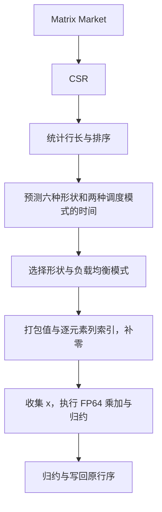

# AtSpMV 算法与实现导读

## 计算目标

稀疏矩阵向量乘为 `y[i] = Σ A[i,j] × x[j]`。CSR 用 `row_ptr` 给出每行非零元素区间，`col_idx` 与 `val` 存储列号和值；直接实现的有效运算量约为 `2 × nnz`。不同行长相差很大时，固定分配线程会造成空闲；直接填成稠密矩阵又会浪费存储与计算。

AtSpMV 对行进行排序，将相近行长组合起来，并在六种包含 32 个槽位的形状中选一种，再按形状分配 warp 内的线程，用普通 FP64 乘加与 shuffle 归约计算。当前 AtSpMV 内核未调用 Tensor Core MMA 包装函数。

## 数据流



### 1. 排序与短行分支

`Spmv` 统计非空行平均长度、行长标准差、最大最小行长。当前代码在 `stand < 12`、`avg_nnz < 8`、最大行长与平均值之比小于 4 时进入普通 FP64 CUDA 路径，减少格式转换成本。

其余矩阵进入 `CSRToAtBSR`：通过 Thrust 计算行长，按长度升序排序，同时保留原始行号。排序改变行的处理顺序，不改变输入向量的列坐标。

### 2. 自适应块形状

| 候选编号 i | 行数 m | 每行槽位 k | 特征 |
| --- | --- | --- | --- |
| 0 | 1 | 32 | 长行，单行内并行 |
| 1 | 2 | 16 | 两行共同处理 |
| 2 | 4 | 8 | 中等行长 |
| 3 | 8 | 4 | 较短行 |
| 4 | 16 | 2 | 短行 |
| 5 | 32 | 1 | 多行并行 |

每种形状满足 `m × k = 32`。一组最多 m 行需要的块数为 `ceil(组内最大行长 / k)`。由于行长已排序，可用该组末行的长度计算。所有组的块数相加得到 `B_i`，填充密度为：

`density_i = nnz / (32 × B_i)`

这里的块按每行非零元素的存储位置打包，保留逐元素列索引，**不是要求列号连续的传统稠密 BSR 子矩阵**。例如两行分别有 3、5 个非零元素，选 2×4 时需要两个块，共 16 个槽位，密度为 8/16。

当前使用预测时间替代原 density 加权分数。GPU 统计每种形状的总 tile 数、拆分后 warp 数、最长行组 tile 数，结合当前设备 SM 数、带宽、时钟和具体内核的 occupancy，估计访存、指令服务、依赖链以及原子更新耗时。

```text
T_predict = launch + max(T_memory, T_issue, T_dependency) + T_atomic
T_dependency = max(每 SM 的 tile 数 / 并发 warp 数, 最长任务 tile 数) × tile_latency
```

两套转换入口都比较 6×2 个候选，并选择预测时间最小者。指定形状时只比较该形状的两种模式。参数、公式、校准方法和已测误差见 [SM 时间模型](performance-model.md)。RTX 5880 Ada 已通过独立矩阵完成冷/热缓存参数校准，其他硬件仍使用未校准默认值；误差范围和最差案例见模型说明。

### 3. 长行负载均衡

模型独立评估普通与均衡模式。均衡模式把一个块行拆成多个任务，每个任务最多处理 8 个块，`warpBlcPtr` 表示任务区间，`targetRowByWarp` 表示任务对应的行组。

普通模式由一个 warp 完成一组行并写回；均衡模式由多个 warp 计算部分和，再通过 `atomicAdd` 合并。拆分能减轻长尾，但增加调度与原子加开销，浮点求和顺序也会发生变化。

### 4. Warp 计算与索引压缩

`include/ptx.h` 定义了 `mma.sync.aligned.m8n8k4.row.col.f64.f64.f64.f64` 包装，但当前 `atspmv.cu` 和 `atspmvProduct.cu` 中的计算内核实际使用普通 double 乘加。不同形状改变每行占用的线程数：1×32 对一行进行 32 线程归约，32×1 则每线程处理一行。

列数满足源码的 16 位索引条件时，打包列号使用 `int16_t`，降低索引带宽；其余使用 32 位。行指针和任务元数据仍保留自己的类型。

## 两套入口

| 入口 | 用途与边界 |
| --- | --- |
| `Spmv`，`src/atspmv.cu` | 接收主机向量，包含选择、转换、计时与结果处理，适合单次基准 |
| `CSRToAtBSRProduct` + `AtSpmvProduct` | 转换一次，反复使用设备向量计算，供 PageRank 等迭代应用使用；内核通过 recorder 写回原行序 |

两个实现仍存在重复，但现在共用时间模型。Product 转换接收设备端 CSR，基准转换接收主机 CSR；二者仍应分别验证。复用预处理的收益取决于迭代次数：只有累计执行时间节省超过转换成本时才有端到端收益。

## 当前实现的已知限制

- 主入口 `Spmv` 的行长初始化、空行统计、定长行标志及零矩阵处理已修正。未使用且未公开声明的历史 `SpmvProd` 包装已移除。Product 转换现在从列数直接确定索引宽度，不再依赖调用方初始化统计字段。
- `AtSpmvProduct` 接收 `alpha`，但当前实现没有应用它；不能把该接口当作完整的 `y = alpha*A*x + beta*y` 实现。`beta` 有独立缩放内核，最终语义还取决于计算分支的写回方式。
- `CSRMatrix`、`AtBsr` 使用裸指针且析构函数未自动释放所有资源，复制对象不会建立独立所有权。不能在未审计调用方前直接补上释放逻辑，否则可能引入重复释放。
- 基准程序中存在关闭的正确性检查，且默认重复次数很小；论文数据不等于当前版本的自动回归结果。

时间模型改动附带了 CPU 模型测试与 GPU 数值回归。基准均衡分支每次迭代前清零输出，避免 warmup/repeat 重复累加；Product 的 beta=0 路径直接赋零，避免读取未初始化输出。后续仍需完善一般 alpha/beta 语义和资源所有权。
