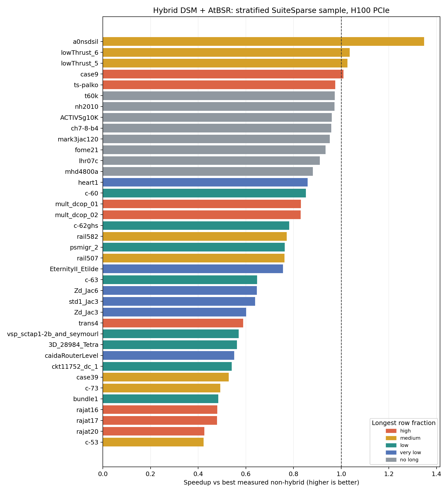

# 长行 DSM 与普通行 AtBSR 的混合 SpMV

全库跑批的进度、固定对照和交叉案例优化见[全库测试与交叉案例分析](dsmem-full-sweep.md)。

`HybridDsmAtBsr` 将 CSR 矩阵按每行非零元数量划分：长度大于等于阈值的行为长行，其余为普通行。创建 Plan 时普通行被压缩成独立 CSR，按普通模式 AtBSR 排序、打包，并将输出映射回原始行号；长行保留原 CSR 和行号。执行时一个 SM90 cluster kernel 同时包含两类完整 cluster：长行 cluster 沿非零元均分一行，使用 QuACK 式异步 DSM 和 `mbarrier` 汇总 FP64 warp 部分和；其他 cluster 执行 AtBSR tile 计算。两类行集合互斥，各写各自的 y，空行也会被覆盖为零。无全局 y 清零或额外合并 kernel，每次均读取当前 x，计算 `y=A*x`。

此混合路径复用 AtBSR 布局与普通模式的计算方法，但短行路径目前**只支持普通模式**，不支持 AtBSR balanced 模式；长行 DSM 支持 cluster size 2/4/8。它是同一个 kernel 中的任务融合，长行和普通行何时运行、是否重叠由硬件调度决定。`Auto, tune=false` 沿用原有 AtBSR 模型；`Auto, tune=true` 在可用时把混合候选加入完整后端的初始化实测，最终选择单个后端。也可显式指定：

```cpp
atspmv::SpmvPlanOptions options;
options.backend = atspmv::SpmvBackend::HybridDsmAtBsr;
options.tile_index = 5;             // 普通行 tile M=32；-1 使用现有模型
options.long_rows = {8, 256, 1, 1024}; // cluster, threads, rows/group, threshold
auto plan = atspmv::makeSpmvPlan(device_csr, options, stream);
atspmv::executeSpmv(plan, device_x, device_y, stream);
```

构建须启用 `ATSPMV_BUILD_DSM_EXPERIMENT=ON`，且 GPU 支持 cluster；不满足时显式请求该后端会报错。`balanced=1` 不适用于混合后端。初始化涉及 CSR 复制、行划分、普通行打包与可选实测；同一阈值/tile 的打包数据在实测候选间共享。初始化实测面向多次复用 Plan 的场景，时间与结果在 `plan.info()` 中报告。输入/输出、所有权和并发约束与[统一 Plan](performance-model.md#统一-spmv-plan-与初始化实测选型)相同。

## 真实数据集结果

在空闲 H100 PCIe 和 CUDA 12.4 上，先对本地 SuiteSparse 数据进行探索性筛选，再对选中的 9 个真实矩阵固定候选配置独立复测。每个后端从筛选结果选出 3 个配置（cuSPARSE 使用 CSR_ALG1）；复测使用 3 个随机交错顺序、每个顺序 21 次计时，每个 CUDA Graph 含 8 次 SpMV，报告每个配置各运行中位数的中位数，再取对应后端最快配置。对照包括 AtBSR、CSR DSM、CSR 两阶段以及 cuSPARSE，每次计时前预热相应 Graph，**不强制清缓存**。

| 数据集 | 混合方案 μs | 所测最佳非混合方案 μs | 最佳非混合后端 | 加速比 |
| --- | ---: | ---: | --- | ---: |
| a5esindl | 4.176 | 5.788 | AtBSR | 1.386× |
| boyd1 | 12.524 | 14.120 | cuSPARSE | 1.127× |
| lowThrust_4 | 4.032 | 4.856 | AtBSR | 1.204× |
| bloweya | 4.096 | 4.832 | AtBSR | 1.180× |
| brainpc2 | 4.804 | 5.136 | AtBSR | 1.069× |
| blockqp1 | 7.932 | 7.272 | cuSPARSE | 0.917× |
| dc1 | 15.248 | 8.960 | cuSPARSE | 0.588× |
| lp_osa_30 | 11.952 | 6.820 | AtBSR | 0.571× |
| connectus | 16.860 | 8.928 | AtBSR | 0.530× |

加速比为非混合耗时除以混合耗时，大于 1 表示混合方案快。9 个矩阵均根据筛选结果选择，既有收益案例也有反例，**不是随机样本或未参与选择的留出集**；各后端仅复测筛选出的有限配置，不能宣称全面优于所有可能实现。计时不包含行划分、AtBSR 打包、cuSPARSE 预处理、Plan 构建和 Graph 创建，因此也不是端到端一次性运行加速比。以 `a5esindl` 为例，一次完整 Auto 实测 Plan 的初始化约 1.12 s，重复复用才能摊薄，且测量开销受主机和设备状态影响。

初步结构分析与结果一致：按阈值 1024，`a5esindl` 为 60008 行、255004 个非零元，其中 4 行长行，占约 9.8% 非零元；`lowThrust_4` 有 2 条长行，占约 6.6%。较少长行可以独立拆分，其余大量短行保持 AtBSR 打包。相比之下，`lp_osa_30` 的 79 条长行占约 82.4% 非零元，`connectus` 的 121 条长行占约 94.8%，混合方案明显落后。结构统计不能单独证明因果：长行长度、索引局部性、SM 并行度、原始 AtBSR 模式和 cuSPARSE 实现都会影响结果，`boyd1` 的长行非零元比例较高但仍有收益。数值仅支持这些测量条件下的判断。

[逐次测量](../results/model/dsm-atbsr-hybrid/final/)、[汇总 CSV](../results/model/dsm-atbsr-hybrid/final/summary.csv)、[输入与源码哈希、设备和计时口径](../results/model/dsm-atbsr-hybrid/final/metadata.json)、[冻结配置](../results/model/dsm-atbsr-hybrid/validation/)。每个复测候选均以两个非均匀 x、NaN 初始化 y，与 CPU long-double 参考对照，且验证 Graph 重放。H100 `spmv_plan` 和原 DSM 长行 CTest 通过；CUDA 13.0 的 memcheck、synccheck 和 racecheck 对 Plan quick 测试通过，详见同一结果目录。这些验证不代表所有矩阵和配置均经 sanitizer 覆盖。

复现（在空闲 H100 上，将设备号与数据集根目录改为本机配置）：

```bash
cmake --build /tmp/atspmv-dsm-sm90-build --target spmv_hybrid_validation spmv_plan_test
CUDA_VISIBLE_DEVICES=3 python3 scripts/analysis/benchmark_dsm_atbsr_hybrid.py \
  --exe /tmp/atspmv-dsm-sm90-build/spmv_hybrid_validation \
  --matrix-root /staff/chengjiajun/workspace/database/suitsparse \
  --config-dir results/model/dsm-atbsr-hybrid/validation \
  --output /tmp/dsm-atbsr-repeat \
  --names a5esindl boyd1 blockqp1 lowThrust_4 bloweya brainpc2 dc1 lp_osa_30 connectus
CUDA_VISIBLE_DEVICES=3 ctest --test-dir /tmp/atspmv-dsm-sm90-build -R '^(spmv_plan|dsm_long_row_.*)$' --output-on-failure
```

## 扩大矩阵覆盖后的评估

为避免只展示已知收益案例，新增一组预先确定的分层样本：从本地 `longest_row_ratio.csv` 中排除此前 37 个筛选矩阵，限定 100–200000 行、最多 1000000 列、100000–2000000 个非零元且本地文件存在。对最大行长度至少为 1024 的矩阵，按“最大行非零元数 / 全矩阵非零元数”分为 ≥0.04、[0.01, 0.04)、[0.001, 0.01)、<0.001 四层；另设最大行长度 <1024 的对照层。每层按固定种子随机抽取 8 个，第四层仅有 6 个，合计 **38 个此前未测矩阵**。这些层被刻意近似等量抽样，不能作为全部 SuiteSparse 矩阵的代表；同一层中也可能包含相关矩阵。

每个矩阵先用 `Auto + tune=true` 做初筛；每个后端按初筛 GPU 时间保留前三个配置，另加入 cuSPARSE CSR_ALG1，再用三个不同随机顺序各测 21 次，每次按 8 次调用的 CUDA Graph 均值计时，报告三个运行中位数的中位数。每个复测候选都用两个不同的非均匀 x 和 NaN 初始化的 y 与 CPU long-double 参考比较，并验证 Graph 重放。测量预热、不强制清缓存，也不含矩阵打包、候选搜索和 Graph 创建；这反映的是复用 Plan 时的 GPU 执行时间。矩阵选择先固定，候选配置依赖本组矩阵初筛，故复测不是独立数据集留出验证；比较范围限于已测候选和 cuSPARSE CSR_ALG1。

| 预先划分的矩阵层 | 矩阵数 | 混合方案快于所测最佳非混合 | 快至少 5% | 慢超过 5% | 混合方案加速比几何平均 |
| --- | ---: | ---: | ---: | ---: | ---: |
| 最大行占比 ≥ 4% | 8 | 1 | 0 | 6 | 0.667× |
| 最大行占比 1%–4% | 8 | 3 | 1 | 5 | 0.743× |
| 最大行占比 0.1%–1% | 8 | 0 | 0 | 8 | 0.638× |
| 最大行占比 < 0.1%，但最大行 ≥ 1024 | 6 | 0 | 0 | 6 | 0.668× |
| 最大行 < 1024 | 8 | 0 | 0 | 3 | 0.942× |
| **总计（分层样本）** | **38** | **4** | **1** | **28** | **0.727×** |

加速比仍定义为“所测最佳非混合时间 / 混合时间”；表中快、慢 5% 以耗时为标准。38 个矩阵的加速比中位数为 0.767×。其中 `a0nsdsil` 的混合方案为 4.188 μs，对照 AtBSR 为 5.644 μs，取得 **1.348×**；三个复测顺序分别约为 1.348×、1.331× 和 1.350×。另外三个小幅收益案例为 `lowThrust_6`（1.036×）、`lowThrust_5`（1.027×）和 `case9`（1.010×），这些较小差异需要结合具体环境和复测波动理解。

反例中，`c-53` 为 12.996 μs 对 5.496 μs，`rajat20` 为 18.328 μs 对 cuSPARSE 的 7.812 μs。初步解释是，当长行量、长度分布或访存模式不匹配当前的固定 cluster 拆分时，DSM 通信、cluster 调度与较低并行度可能抵消收益；仅用最大行占比无法确定原因，也不能作为充分的自动选型规则。尤其是未超过阈值的行本来也能由 AtBSR 处理，而把它们放进 cluster kernel 仍可能增加调度成本。

初筛的 `Auto + tune=true` 在 38 个矩阵中选择混合后端 5 次；将**初筛实际选中的配置**放到独立复测中，与复测的所测最佳非混合方案比较，其比值几何平均为 0.981×。此对照包含不在当前 Auto 候选中的 cuSPARSE，而且基线按复测结果选取，因此不能解释为线上选型总是达到最佳值；混合后端在这 5 次选择中有 2 次在复测中落后于最佳非混合。默认 `Auto + tune=false` 仍使用现有 AtBSR 模型。



[分层和实际选型统计](../results/model/dsm-atbsr-hybrid/expanded/final/analysis.json)、[全部矩阵与性能明细](../results/model/dsm-atbsr-hybrid/expanded/final/analysis.csv)、[复测配置与输入/源码哈希](../results/model/dsm-atbsr-hybrid/expanded/final/metadata.json)、[预先固定的抽样清单](../results/model/dsm-atbsr-hybrid/expanded/manifest.json)和[初筛状态](../results/model/dsm-atbsr-hybrid/expanded/screen-status.json)。

复现该固定清单的复测（需空闲 H100、相同本地数据集和已构建的 SM90 程序）：

```bash
CUDA_VISIBLE_DEVICES=3 python3 scripts/analysis/benchmark_dsm_atbsr_hybrid.py \
  --exe /tmp/atspmv-dsm-sm90-build/spmv_hybrid_validation \
  --matrix-root /staff/chengjiajun/workspace/database/suitsparse \
  --config-dir results/model/dsm-atbsr-hybrid/expanded/configs \
  --output /tmp/dsm-atbsr-expanded-repeat \
  --names $(cat results/model/dsm-atbsr-hybrid/expanded/names.txt)
python3 scripts/analysis/analyze_dsm_atbsr_expanded.py results/model/dsm-atbsr-hybrid/expanded
```
