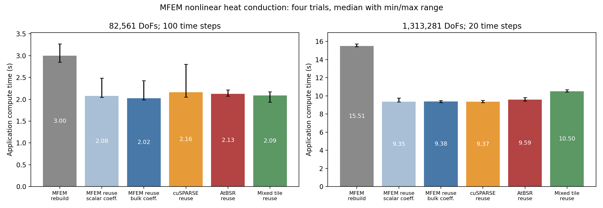

# AtSpMV 的 MFEM 热传导应用

最新的 [原生 AtBSR 分组布局优化](mfem-native-atbsr.md) 已在双方关闭 L2 保留策略时
完成独立复测：默认 CPU 调度下完整应用相对 cuSPARSE 为 1.0199x，统一 CPU 绑定时
为 1.0231x。该结果来自布局和内核改动，与下文历史 L2/逐 tile 压缩实验分开报告。

## 应用与接入范围

项目已接入 MFEM v4.8 的开源热传导示例 `examples/ex16.cpp`，上游提交
`a01719101027383954b69af1777dc828bf795d62`，许可证为 BSD-3-Clause。
[上游源码](https://github.com/mfem/mfem/blob/a01719101027383954b69af1777dc828bf795d62/examples/ex16.cpp)
和 [MFEM 组装方式说明](https://mfem.org/howto/assembly_levels/) 可用于核对问题定义及 GPU 路径。
这是一套完整的有限元示例应用，包含读取与细化网格、投影初温、组装质量与扩散矩阵、
隐式时间推进、线性求解和温度场输出；没有将矩阵文件循环 SpMV 当作完整仿真。
它仍是研究用示例，不能等同于已经完成大型工业仿真软件的生产集成。

问题为绝热边界下的温度相关扩散：

\[
\partial_t u=\nabla\cdot((\kappa+\alpha u)\nabla u),\qquad
M\dot u=-K(u)u.
\]

沿用上游的上一时间步温度线性化；隐式 Euler 每步解
`(M + dt*K) k = -K*u`，再更新温度。默认参数比较使用 `kappa=0.5`、`alpha=0.01`、
`dt=0.01`、相对容差 `1e-8`、Jacobi 预处理 CG；为允许大网格收敛，所有后端统一将
隐式 CG 上限由上游的 100 改为 2000。不同矩阵乘次序可能导致边界附近迭代次数差一，
实验同时记录实际次数并检查完整温度场，不能假定次数必然相同。

## 实现

- `apps/mfem/heat.cpp`：保留 MFEM 的离散、积分与求解流程，增加可切换矩阵乘与分阶段计时。
- `apps/mfem/spmvOperator.hpp`：将 MFEM `Operator::Mult` 接到现有 `SpmvPlan`。
- `updateSpmvValues`：为固定 CSR 结构提供数值更新。AtBSR 复用行排序和 tile 偏移，mixed
  复用行组/shape；CSR 后端复制数值。结构必须保持不变，混合 DSM/AtBSR 暂不支持该接口。
- `apps/mfem/sparseSum.*`：缓存 `M+dt*K` 的符号并集及条目映射，在 GPU 更新和矩阵数值。
  对 CSR 偏移和列索引在 GPU 逐项精确比较，只回传判定标志；结构变化时重建。

所有比较使用单张 H100 PCIe、串行 MFEM、FP64、int32 CSR、同一 CUDA 默认 stream。
`mfem` 是原生 GPU SparseMatrix 后端；`cusparse` 是统一 Plan 中显式的 CSR_ALG1；
`atbsr` 是现有自适应六形状方案；`mixed` 是现有 mixed-tile 后端；`tuned` 实测 Plan 的
有界候选集。后端的构造、转换与实测选型成本均进入应用计算计时；最终析构计入
进程墙钟。不能将事后最快候选当成已经实现的在线选择器。

GPU full assembly、隐式矩阵结构复用等应用层优化，对原生 MFEM、cuSPARSE 和 AtSpMV
共同开启；其收益应单独消融，不能归因于 tile shape。GPU full assembly 会产生显式 CSR，
与 partial assembly / matrix-free 不同。比较也不代表优于这些不同的离散执行路径。

## 正确性与时间口径

每个应用进程检查 CG 收敛、温度有限、绝热热量守恒及离散能量不增加；比较最终整个
温度向量相对最大差，而不只看 checksum。使用固定输入、种子无关的初温、正反交替
后端顺序，并记录每轮输入命令、可执行文件哈希、最终场与原始日志。

- `initialization_s`：从 main 到时间推进前，包括 CUDA context、网格细化、初始有限元
  组装、Plan 构造和初始热量/能量检查。
- `evolution_s`：完整时间推进，包含线性求解、该阶段发生的系数/矩阵更新及 Plan 维护。
- `total_s`：前两项对应的应用计算墙钟；排除最终验证、输出与析构。
- `process_wall_s`：外部测得的子进程墙钟，另外包含最终验证、本地场输出和析构；
  不包括后续将结果归档到网络文件系统的时间。
- `linear_s`：RHS 矩阵乘与 CG 的累计墙钟，包含向量运算及归约，不能称为纯 SpMV 时间。
- `parameter_s` 和 `implicit_setup_s`：分别定位系数/K 更新、隐式矩阵构建及维护；
  这些辅助计数并非与其他计数互斥的完整时间分解。

性能统计以各目录 `summary.json` 为准。`application_speedup` 等字段为配对时间比的
几何平均；另提供中位时间之比，两者不能混用。只有一轮的小样本属于探索；CPU
组装时间波动明显，必须结合线性求解计时，不能把主机波动解释为 GPU 内核收益。

## 独立参考与历史批次处理

MFEM 原始 ex16 是 CPU 示例。移植到 CUDA 时发现，`GridFunction::operator()(i)`
只访问主机指针，不会同步 host/device 有效标志。必须先显式调用 `HostReadWrite()`，
再更新温度相关系数，否则 GPU 系数投影可能读取旧值。这是物理问题定义的错误，
并非通常的浮点误差。多个后端共同出错时，后端间一致、热量守恒和能量下降仍可能通过。

当前对两种系数循环均使用显式同步的主机视图。独立参考使用上游 ex16 的 CPU 路径，
仅将输出精度改为 17 位，并把 CG 上限统一为 2000；补丁和哈希保存于
`coherent-provenance`。`validate_mfem_cpu_reference.py` 对不同网格细化程度比较整个
温度场。`coherent-*` 之前的应用批次只保留作排错，不纳入论文性能结论，详见
`results/applications/mfem-heat/KNOWN_ISSUE.md`。

性能结论以校正系数同步后的同轮结果为准。尚未完成的测量不作为加速证据。

独立 CPU 参考检查已完成：1361 和 20801 个自由度、各 3 个隐式时间步，四种
GPU 后端与上游 CPU 温度场的相对最大差在 `9.04e-16` 至 `5.43e-15` 范围。
结果见 `coherent-cpu-reference/summary.json`。两个场景之外的准确性仍须按输入验证。
校正版本可执行文件 SHA256 为
`5026aaeacd4fba0a68b6263ef75838961961bf9710acb729419fa6322be12190`，
源码、上游 CPU 补丁及哈希位于 `coherent-provenance`。

## 校正后的性能结果

本节为启用结构复用、尚未启用 X 的 L2 保留和列索引压缩的对照；后续优化结果见下一节。

四轮正反交替对照已全部正常结束，共 48 个应用进程。两种规模均使用同一二维
`star.mesh`、H1 二阶有限元、非线性系数与隐式 Euler。小组为 82561 自由度、
1313281 个存储条目、100 步；大组为 1313281 自由度、20981761 个存储条目、20 步。
以下时间为应用计算墙钟中位数，加速比为各轮相对逐步重建参考的配对几何平均，
所以加速比不必等于表中两个中位时间之比。预处理、矩阵上传和构造均包含在内。

| 方案 | 小组时间/s | 小组加速比 | 大组时间/s | 大组加速比 |
|---|---:|---:|---:|---:|
| MFEM 每步重建参考 | 2.997 | 1.000× | 15.512 | 1.000× |
| MFEM 结构复用，逐元素系数循环 | 2.078 | 1.397× | 9.348 | 1.645× |
| MFEM 结构复用，批量系数循环 | 2.024 | 1.435× | 9.378 | 1.659× |
| cuSPARSE + 结构复用 | 2.163 | 1.328× | 9.366 | 1.658× |
| AtBSR + 结构复用 | 2.126 | 1.418× | 9.590 | 1.617× |
| 混合 tile + 结构复用 | 2.088 | 1.463× | 10.500 | 1.477× |

**结论：已在开源热传导应用上获得应用级收益，但不是六种 tile 带来同等幅度的内核收益。**
大组 AtBSR 方案相对每步重建参考为 1.617×，时间中位数从 15.512 s 降至 9.590 s；
同样的结构复用加到 MFEM 原生或 cuSPARSE 后分别为 9.378 s 和 9.366 s，略快于 AtBSR。
因此不能宣称 AtBSR 在这一大规模有限元矩阵上优于优化后的 cuSPARSE；目前证据支持
复用矩阵结构、减少转换与重复符号分析能够提升完整应用性能。

这两组 AtBSR 都由现有模型选中 `32×1`、普通模式。大组 mixed 的 Plan 构造、上传及
数值维护累计中位时间为 1.336 s，AtBSR 为 0.299 s；两者线性求解累计时间分别为
5.630 s 和 5.654 s，差异很小。混合布局的维护成本没有被求解收益摊薄，应用总时间
因此更高。`linear_s` 包括完整 CG 和向量运算，不是独立 SpMV 内核时间。

原始数据为 `coherent-r5/` 和 `coherent-r7/`。审计脚本重新检查了 48 个退出状态、
步数、数学配置、可执行文件哈希、物理不变量和最终完整向量；最大后端间相对场差
为 `8.67e-14`，最大相对热量偏差为 `3.99e-8`，两组所有后端 CG 总迭代次数一致。
审计与统计见 [报告数据](../results/applications/mfem-heat/report/summary.json)、
[逐轮 CSV](../results/applications/mfem-heat/report/trials.csv)。



图中误差线为四轮最小/最大范围，不是置信区间。共享机器存在初始化和主机调度波动，
小组结果尤其不宜解释为稳定的几何结构普适性。没有计算跨矩阵集合的总体加速比。

复现统计与图表：

```bash
OPENBLAS_NUM_THREADS=1 python3 scripts/analysis/analyze_mfem_application.py
```

后台入口 `results/applications/mfem-heat/run_coherent.sh` 已结束；无需再等待设备。

## 后续优化：超过同配置 cuSPARSE

**归因更新：** 已完成 [列索引压缩的 2x2 消融](mfem-column-ablation.md)。压缩在大矩阵
上提升单次 SpMV 和完整 CG，但单独开启时没有稳定的应用总时间收益，小矩阵还会
退化。下述相对 cuSPARSE 的 1.0294x 是组合方案的历史测量，不能当作压缩单项收益。

在相同的大组问题上，增加了两项可独立开关的优化：

1. **保留 X 的 L2 缓存窗口。** `-persist-x` 为当前 SpMV 输入配置 persisting access
   policy，按设备容量设置保留空间，输入地址改变时更新窗口。此矩阵的 X 约 10.5 MB，
   可以放入 H100 的保留范围。cuSPARSE 对照也启用完全相同的窗口策略。
2. **无损压缩 tile 内的列索引。** 普通 `32x1` 中，一个 tile 的 32 个列号来自不同的行，
   虽然每行的列号跨度很大，同一 tile 内的跨度往往很小。GPU 按跨度选用 8 位或 16 位
   相对偏移，跨度过大时保留 32 位索引。数值仍为 FP64。列索引与解码元数据从
   83,931,008 字节降到 40,185,208 字节，减少 52.1%。构建、prefix scan 和编码均在
   GPU 完成，后续数值更新继续复用原有布局；不节省空间时回退。

入口为 `-b atbsr-compressed -persist-x`；Plan 选项为 `compress_tile_columns`。
实现见 `include/detail/compressedTileColumns.cuh`，当前只支持普通 `32x1` 的原始
int32 列索引布局，使用两路独立累加。已有预测模型尚未针对它标定，默认不自动启用。
其他 shape、balanced 模式或已有 int16 索引均保留现有实现。

先完成四轮探索对照，再冻结最终实现进行**独立八轮正反交替复测**。两边均启用相同的
GPU full assembly、结构/数值复用和 L2 窗口，沿用相同网格、20 个时间步、Jacobi、
CG 精度及上限，计时保留全部初始化、压缩和每步维护成本。复测结果如下：

| 计时项（八轮中位数） | cuSPARSE + L2 窗口 | 压缩 AtBSR + L2 窗口 |
|---|---:|---:|
| 应用计算墙钟 | 9.404 s | 9.125 s |
| RHS SpMV + 完整 CG | 5.442 s | 5.249 s |
| Plan 构造、上传与维护累计 | 0.256 s | 0.287 s |
| 包含最终检查、输出和析构的进程墙钟 | 9.777 s | 9.494 s |

压缩方案八轮均快于 cuSPARSE，应用计算墙钟的配对几何平均加速比为 **1.0294x**，
进程墙钟为 **1.0311x**。配对轮次 bootstrap 的应用加速比 95% 区间为
`[1.0142, 1.0477]`，只描述这组重复试验，不代表跨矩阵分布的区间。每轮双方均为
15301 次 CG 迭代、15321 次 SpMV，最终温度场最大相对差为 `7.49e-14`。

实际隐式矩阵的独立 kernel 重放也进行了三轮对照；表中为三轮中位时间，每轮由九个
Graph 批次的中位时间得到。该测量排除构建成本，不能代替上面的应用结果。

| 单次 SpMV | 默认缓存 | 相同的 X 保留策略 |
|---|---:|---:|
| cuSPARSE | 155.87 us | 155.68 us |
| 原 AtBSR，预取深度 2 | 171.10 us | 152.80 us |
| 压缩 AtBSR | 160.17 us | 145.85 us |

Nsight Compute 在第一步求解中跳过 100 次匹配的 SpMV 后，对一次调用采样：

| 配置 | HBM 读取量 | 整个 kernel 的 L2 sector 命中率 |
|---|---:|---:|
| 原 AtBSR | 295.04 MB | 20.33% |
| 原 AtBSR + 保留 X | 267.95 MB | 24.22% |
| 压缩 AtBSR + 保留 X | 225.26 MB | 30.02% |

这些计数支持减少 HBM 读取的解释；命中率是 kernel 的聚合计数，不能当成 X 的独立
命中率。为了保留实际缓存状态，profile 关闭自动清缓存，未锁 GPU 时钟；单次计数
只作机制证据，性能时间使用未 profile 的独立测量。收益来自缓存策略、索引流量和
相应执行实现，不应归因于更换 shape：原模型和六种 shape 实测均选择了 `32x1`。

新路径通过三种列范围下的数值更新和 Graph 检查、专门的 memcheck（零错误），以及
20801/82561 自由度的上游 CPU 完整温度场对照，最大 CPU 参考相对差 `1.29e-14`。
常规更新套件共 84 配置、Plan 套件 956 项检查通过。完整更新套件的 memcheck 在已有
DSM 规约中报共享内存错误，原因尚未确定；日志保留在 `optimized-validation/`，不算
通过。本次应用、压缩路径和性能结论均不使用 DSM。

原始独立复测见 `optimized-confirmation-r7/`，计数器见 `optimized-profile/`；
[审计汇总](../results/applications/mfem-heat/optimized-report/summary.json)、
[逐轮时间](../results/applications/mfem-heat/optimized-report/trials.csv) 和
[图表](../results/applications/mfem-heat/optimized-report/comparison.png) 可直接查看。
最终可执行文件、相关源码快照和哈希保存在
[复现记录](../results/applications/mfem-heat/optimized-provenance/provenance.json)。

```bash
CUDA_VISIBLE_DEVICES=3 OPENBLAS_NUM_THREADS=1 python3 scripts/analysis/benchmark_mfem_heat.py \
  --exe /tmp/atspmv-mfem/apps/mfem/mfem_heat --mesh /tmp/mfem/data/star.mesh \
  --output /tmp/mfem-confirmation --refine 7 --steps 20 --alpha 0.01 --rounds 8 \
  --backends cusparse,atbsr-compressed --prefetch 2 --persist-x --gpu-assembly
OPENBLAS_NUM_THREADS=1 python3 scripts/analysis/analyze_mfem_optimization.py
```

目前仅证明这一大规模热传导 case 可超过同配置 cuSPARSE，不能推断所有矩阵都会获益。
X 超出 L2 保留空间、tile 内列号跨度大或复用次数不足时，需要重新评估。

## 运行与局限

构建及运行见 [MFEM 应用说明](../apps/mfem/README.md)，MFEM 默认不作为构建依赖。
脚本 `scripts/analysis/benchmark_mfem_heat.py` 可复现单个配置；后台入口在结果目录下，
使用 tmux 和 GPU 空闲检查，连接断开后仍可运行，遇到竞争会重试。

当前只验证串行 CUDA 显式矩阵路径；多 GPU 通信、AMG、不同预处理器、matrix-free
和工业应用并未验证。不能由热传导示例推断所有有限元或全部开源应用均有收益。
