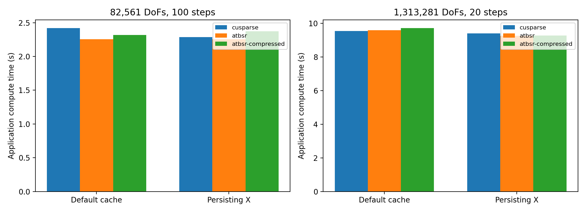
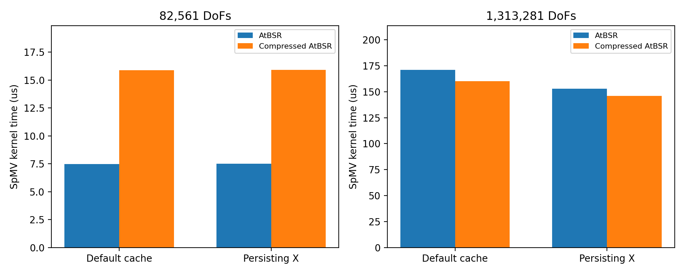

# MFEM 中 tile 列索引压缩的消融实验

## 结论

**无损列索引压缩能提升这个大矩阵的单次 SpMV 和求解阶段性能，但没有证明完整应用
有稳定的额外加速；小矩阵明显退化。** 此前相对 cuSPARSE 的组合方案加速比，不能
当作压缩单项收益。X 的 L2 保留策略是另一个独立因素。

固定压缩开关以外的配置，结果如下。所有加速比方向均为“不压缩时间 / 压缩时间”，
大于 1 表示压缩有利。应用和 CG 加速比是八轮配对比值的几何平均；内核加速比为
三轮内核时间中位数之比。

| 自由度 | X 的 L2 保留 | 单次 SpMV 加速比 | RHS SpMV + 完整 CG 加速比 | 应用总加速比 |
|---|---|---:|---:|---:|
| 82561 | 关闭 | 0.470x | 0.904x | 0.953x |
| 82561 | 开启 | 0.472x | 0.905x | 0.944x |
| 1313281 | 关闭 | 1.068x | 1.037x | 0.993x |
| 1313281 | 开启 | 1.048x | 1.021x | 0.993x |

## 实验控制

- H100 PCIe GPU 3；FP64；同一冻结可执行文件
  `03352fff3a5b9eb285ad4f768bd5d2e307822c4615974c7c1a4db266b1cfa719`。
- 相同 `star.mesh`、H1 二阶有限元、非线性系数 0.01、隐式 Euler、步长 0.01、
  Jacobi 和 CG 相对容差 1e-8。小组 100 步、1313281 个存储条目；大组 20 步、
  20981761 个存储条目。
- 两边固定普通 `32x1`、每 CTA 4 个 warp、预取深度 2、两路累加。逐个检查三个
  Plan 的实际日志，确认形状、模式相同，压缩版本确实使用了压缩列索引。
- 因素为压缩开/关和 X 的 L2 保留开/关；GPU full assembly、矩阵结构及数值复用
  始终开启。cuSPARSE 在两种缓存条件下作为额外对照。
- 每个规模、每个条件八轮，轮换后端顺序并交替缓存条件与规模顺序。共 96 个成功
  应用进程，其中 AtBSR 四种组合共 64 个，cuSPARSE 共 32 个。
- 应用计算墙钟包含初始化、压缩构建与每步维护，排除最终检查、输出与析构；另存
  包含这些操作的进程墙钟。结果先输出到本地 `/tmp`，归档 NFS 的时间不计入进程。
- 每轮比较完整温度场，CG 迭代及 SpMV 调用次数与同轮 cuSPARSE 相同；最大温度场
  相对差为 `7.49e-14`。全部通过收敛、有限性、热量及能量检查。

## 应用计时与不确定性

以下为八轮时间中位数，不能直接与几何平均加速比混用。

| 自由度 | L2 保留 | 未压缩总时间/s | 压缩总时间/s | 未压缩 CG/s | 压缩 CG/s |
|---|---|---:|---:|---:|---:|
| 82561 | 关闭 | 2.254 | 2.318 | 0.804 | 0.886 |
| 82561 | 开启 | 2.253 | 2.372 | 0.794 | 0.890 |
| 1313281 | 关闭 | 9.580 | 9.719 | 5.602 | 5.397 |
| 1313281 | 开启 | 9.256 | 9.268 | 5.341 | 5.241 |

大矩阵两种缓存条件下，压缩的求解阶段八轮均更快，几何平均分别为 1.0371x 和
1.0206x；但应用总时间都只有两轮更快。应用总加速比的配对 bootstrap 95% 区间分别为
`[0.9715, 1.0181]` 和 `[0.9746, 1.0107]`，均跨过 1，**不能宣称端到端稳定加速**。
区间只描述这些重复轮次，不代表跨矩阵集合的统计区间。

大矩阵 Plan 构造、上传及维护累计中位时间，默认缓存下由 0.301 s 增至 0.342 s，
保留 X 时由 0.297 s 增至 0.316 s。额外维护成本真实存在；同时观测到初始化、组装
墙钟波动，不能把总时间差全归因于压缩构建。当前证据支持局部求解收益，尚不足以
使其在完整应用中稳定兑现。

小矩阵的 CG 阶段两种缓存条件下八轮全部退化。应用总加速比区间分别为
`[0.8924, 1.0085]` 和 `[0.9016, 0.9918]`，没有正收益证据。

作为独立消融，大矩阵原 AtBSR 仅开启 X 的 L2 保留时，应用配对加速比为 1.0291x，
95% 区间 `[1.0178, 1.0396]`。这说明通用缓存优化和索引压缩必须分别归因。



## 独立内核与指令证据

使用各规模第一个隐式矩阵独立重放。每个条件三轮，每轮测九个 Graph batch，
每 batch 八次 SpMV。表中为每轮 batch 中位数再取三轮中位数；不包含构建时间，
也没有 CG 的其他向量内核，因此不可代替应用测量。

| 自由度 | L2 保留 | 未压缩/us | 压缩/us |
|---|---|---:|---:|
| 82561 | 关闭 | 7.460 | 15.884 |
| 82561 | 开启 | 7.512 | 15.908 |
| 1313281 | 关闭 | 170.988 | 160.092 |
| 1313281 | 开启 | 152.988 | 145.996 |



Nsight Compute 在保留 X 的一次应用求解中，跳过 100 次匹配调用后采样：

| 自由度 | 指标 | 未压缩 | 压缩 |
|---|---|---:|---:|
| 82561 | HBM 读取量/MB | 16.708 | 13.720 |
| 82561 | 执行指令计数 `smsp__inst_executed.sum` | 768426 | 1669373 |
| 1313281 | HBM 读取量/MB | 267.958 | 225.281 |
| 1313281 | 执行指令计数 `smsp__inst_executed.sum` | 12257346 | 25807289 |

压缩减少了列索引流量，却新增元数据读取、类型判断、偏移解码，以及“元数据 → 列号 →
X 地址”的依赖链。指令计数约增加至 2.1 倍。大矩阵中减少 HBM 流量可以覆盖这些成本；
小规模工作集更容易被缓存，节省访存的价值下降，新增解码成本反而使内核更慢。
这里的直接证据是读取量下降、指令增加和实测退化；不能仅依据矩阵小于 L2 容量就
断言应用中所有读取都命中 L2。

Profile 未自动清缓存、未锁时钟，仅用于机制分析，不使用 profiler 内的耗时作性能
结论。kernel 重放与实际 CG 的缓存状态也不同，不能将二者混合推算带宽。

## 复现与原始数据

主入口：`scripts/analysis/ablate_mfem_columns.py`。该脚本支持中断后严格校验输入及
可执行文件身份再恢复；已在 tmux 会话 `atspmv_column_ablation_1104` 正常结束。

```bash
OPENBLAS_NUM_THREADS=1 python3 scripts/analysis/ablate_mfem_columns.py \
  --exe /tmp/atspmv-mfem-compressed-v3 \
  --mesh /tmp/atspmv-mfem-v4.8/data/star.mesh \
  --output results/applications/mfem-heat/column-ablation-r5-r7 --gpu 3 --rounds 8
```

应用结束后执行该结果目录中的 `run_diagnostics.py`，可重建独立矩阵并重放 kernel、
采集计数器；无需重跑应用部分。主入口的 `--analyze-only` 只重新校验和汇总应用数据；
`run_diagnostics.py --analyze-only` 只重建内核统计和图表，不执行 GPU 测量。

原始路径为 `results/applications/mfem-heat/column-ablation-r5-r7/`：

- [配对统计及区间](../results/applications/mfem-heat/column-ablation-r5-r7/report/summary.json)
- [96 次应用进程数据](../results/applications/mfem-heat/column-ablation-r5-r7/report/trials.csv)
- [内核及计数器汇总](../results/applications/mfem-heat/column-ablation-r5-r7/report/diagnostics.json)
- `kernels-r5/`、`kernels-r7/` 保存各轮 CSV、profile 和输入/命令哈希。

当前应保留压缩的显式开关，针对大工作集、确实受矩阵读取限制的 case 评估；不宜
仅凭存储体积下降就默认启用，也不宜用组合方案相对 cuSPARSE 的加速比替代单项消融。
