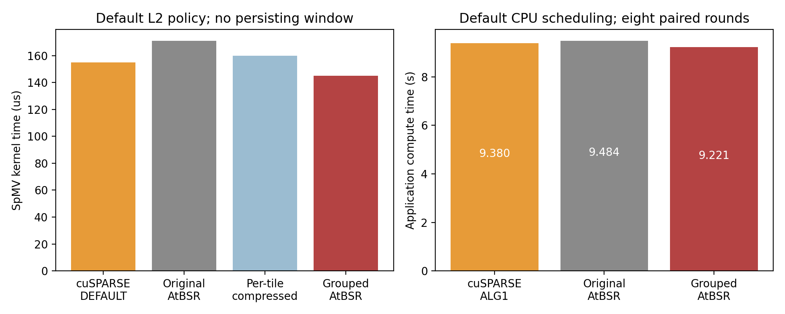

# 不依赖 L2 保留策略的原生 AtBSR 优化

## 结果与边界

新增按索引宽度分组的 AtBSR 布局。在当前 H100 大规模热传导问题上，关闭双方的
X 保留策略，新内核快于 cuSPARSE，完整应用也获得小幅收益。默认 CPU 调度下八轮
应用配对加速比为 **1.0199x**，其中六轮更快；相同 CPU 绑定条件下另八轮为
**1.0231x**、八轮均更快。这是特定问题的结果，不代表整个矩阵集合上的普遍优势。

没有修改 PDE、求解器、预处理器、容差、FP64 精度或迭代上限。改动在 AtSpMV
自身的索引布局、执行内核、GPU 构建和数值更新中；不设置 L2 保留窗口，也不使用 DSM。
所有应用日志均确认 `--no-persist-x`。

此前矩阵的后续复测见 [24 个历史矩阵的 H100 对照](grouped-columns-prior-matrices.md)：
保留原 AtBSR shape/均衡选择时，开启分组的全样本几何加速比为 1.089x；实际启用的
16 个矩阵为 1.142x。存在退化样本，全样本仍慢于 cuSPARSE，不能从 MFEM 的收益
推导出默认全局开启。

## 从变长逐 tile 解码改为定长分组流

上一版逐 tile 压缩需要按以下依赖链读取每个条目：

```text
tile 元数据 → 变长索引位置 → 索引类型判断与解码 → X 的地址 → 乘加
```

新布局在每个 32 行组内，将 tile 按 8/16/32 位编码分为三个区间，在全矩阵的三个
定长池中存放列索引和对应 FP64 值。每个 warp 仍负责原来的 32 行，分别遍历三个区间，
在寄存器中汇总后写回一次结果。

```text
tile 序号 → 定长索引位置 ──┐
             tile 基准 ───┴→ 列号 → X 的地址 → 乘加
```

索引位置由 `tile * 32 + lane` 直接计算，可以与基准读取并行；三个循环分别特化为
uint8、uint16、int32，去掉了每个 tile 的类型分支。没有增加 kernel 拆分或输出原子加。
这项优化不依赖 9/15/25 等特定行长，也没有把矩阵或向量值写死到 kernel 中。

构建在 GPU 上分类并计算三个 prefix sum，随后编码和重排一次。开启数值更新时，
保存每个目标 tile 的原行组及行内位置，用一个 kernel 从原 CSR 顺序直接更新值数组；
无需逐步重新分类、压缩，或先更新旧布局再做第二次重排。

实现为 `include/detail/groupedTileColumns.cuh`，由 `SpmvPlan` 管理生命周期。
当前支持普通 `32x1` 的 int32 列索引输入；其他布局、已有 int16 索引或没有空间收益时
保留原实现。仅改变整数表示和浮点累加顺序，所有矩阵数值和累加仍为 FP64。

## 独立内核对照

在实际隐式矩阵上三轮独立重放，每轮九个 Graph batch、每 batch 八次调用。下表为
每轮 batch 中位数再取三轮中位数，关闭 L2 保留。cuSPARSE 各算法均执行 preprocess，
均通过完整输出对照。此计时排除初始化，完整应用成本在下一节报告。

| 内核 | 82561 自由度/us | 1313281 自由度/us |
|---|---:|---:|
| cuSPARSE CSR_ALG1 | 11.180 | 155.824 |
| cuSPARSE DEFAULT | 11.064 | 154.864 |
| cuSPARSE CSR_ALG2 | 19.392 | 173.628 |
| 原 AtBSR `32x1`，预取 2 | 7.512 | 171.008 |
| 逐 tile 压缩 | 15.388 | 159.836 |
| 新分组布局 | 8.936 | 144.984 |

大矩阵上，新布局比这三个 cuSPARSE 算法中最快的 DEFAULT 约快 1.068x。
小矩阵中原 AtBSR 仍比新布局更快，因此不能默认替换所有普通 `32x1`。
原始数值见结果目录 `report/kernels.csv`，避免将不同批次的小数混用。

## 完整应用独立复测

同一 H100 PCIe，MFEM v4.8，`star.mesh` 七次细化、H1 二阶、1313281 自由度、
20981761 个存储条目、20 步，非线性系数 0.01。Jacobi-CG 相对容差 1e-8，隐式 Euler
步长 0.01。双方均启用相同的 GPU full assembly 和结构复用，均关闭 X 保留。

每轮比较 cuSPARSE CSR_ALG1、原 AtBSR、新布局，轮换顺序。另做两组独立八轮：
第一组统一绑定到 GPU NUMA 节点的 CPU 30，用于控制主机噪声；第二组保留默认 OS
调度，确认收益不依赖绑定。CPU 绑定对所有后端相同，不计作 AtSpMV 的优化贡献。
共 48 个正式应用进程，均通过完整温度场、物理不变量和收敛检查。

| CPU 条件 | cuSPARSE 总时间/s | 原 AtBSR/s | 新布局/s | 新布局相对 cuSPARSE |
|---|---:|---:|---:|---:|
| 统一 CPU 30 | 9.211 | 9.383 | 8.942 | 1.0231x |
| 默认 OS 调度 | 9.380 | 9.484 | 9.221 | 1.0199x |

时间为八轮中位数；加速比为同轮时间比的几何平均，二者不能直接互相换算。
总时间包含初始化、转换、分类、重排和每步数值维护，排除最终检查、输出与析构；
另记录包含这些操作的进程墙钟。未将归档到 NFS 的时间混入子进程计时。

CPU 30 组的应用加速比 bootstrap 95% 区间为 `[1.0172, 1.0297]`；默认调度组为
`[1.0010, 1.0405]`，后者仍有明显主机波动。进程墙钟加速比分别为 1.0245x 和
1.0177x。区间仅针对这些重复轮次，不代表跨矩阵集合的置信区间。

求解阶段累计时间包括 RHS SpMV、完整 CG、向量运算和归约：CPU 30 组由 cuSPARSE
的 5.446 s 降到 5.179 s，默认调度组由 5.456 s 降到 5.203 s。对应配对加速比为
1.0518x 和 1.0490x，两组都八轮更快。所有正式进程均为 15301 次 CG 迭代、15321 次
SpMV，因此收益不来自放宽精度或减少求解工作。

CPU 30 组 Plan 构造、上传及维护中位时间分别为 cuSPARSE 0.261 s、原 AtBSR 0.289 s、
新布局 0.297 s；默认调度组为 0.266/0.295/0.298 s。新布局额外成本已包含在应用结果中。

## 机制与存储成本

在无 L2 保留的第一步求解中，跳过 100 次匹配调用后，Nsight Compute 单次采样为：

| 内核 | HBM 读取/MB | 执行指令计数 |
|---|---:|---:|
| 原 AtBSR | 295.199 | 12257346 |
| 逐 tile 压缩 | 250.255 | 25807289 |
| 新分组布局 | 246.709 | 15184402 |

相对逐 tile 压缩，HBM 读取量只略有减少，执行指令计数却减少约 41%，支持“减少
动态解码与地址依赖”这一解释。相对原 AtBSR，新布局仍有解码开销，但在此大矩阵上
访存节省可以覆盖这些成本。计数器是单次辅助证据；profile 未自动清缓存、未锁时钟，
不能使用其耗时替代未 profile 的独立测量，也不能把聚合 L2 命中率当作 X 的命中率。

该矩阵运行时列索引、区间和基准占 38,269,128 字节；数值更新另外保存 5,245,688 字节
映射。不能忽略这项映射成本来报告总存储收益。值数组大小不变，独占所有权时释放
旧列索引和值暂存；共享调优存储时保持原所有者存活。

## 正确性、使用与复现

- 90 组数值更新配置通过直接调用和 Graph 重放，覆盖 16 位输入回退、8/16/32 位
  编码、空行、不满 32 行及共享 balanced 打包的填充项。
- 对两个压缩实现及回退、共享调优路径的九组 memcheck 检查为零错误；原有 DSM 的
  sanitizer 问题并未宣称解决，本次路径不使用 DSM。
- 956 项原 Plan 直接/Graph/参考检查通过。
- 20801/82561 自由度的三个时间步与上游 CPU 示例完整温度场对照通过，最大相对差
  `1.36e-14`。正式大规模进程对 cuSPARSE 的最大相对差不超过 `7.49e-14`。

库接口见 [统一 Plan](unified-mixed-plan.md)。应用使用 `-b atbsr-grouped -no-persist-x`，
保留默认开关关闭的行为；已有性能模型尚未标定此布局，不自动按矩阵大小启用。

```bash
OPENBLAS_NUM_THREADS=1 python3 scripts/analysis/benchmark_mfem_native.py \
  --exe /tmp/atspmv-mfem-grouped-v2 --mesh /tmp/atspmv-mfem-v4.8/data/star.mesh \
  --output /tmp/mfem-native-default --gpu 3 --cpu -1 --rounds 8
```

原始路径为 `results/applications/mfem-heat/native-optimization/`。
`confirmation-r7/source/` 保存 CPU 绑定实验的原始驱动版本；默认调度实验用当前驱动。
分析与图表可由该目录的 `analyze.py` 从原始输出重建。

- [正式应用与内核汇总](../results/applications/mfem-heat/native-optimization/report/summary.json)
- [默认调度逐轮 CSV](../results/applications/mfem-heat/native-optimization/confirmation-unbound-r7/trials.csv)
- [CPU 绑定逐轮 CSV](../results/applications/mfem-heat/native-optimization/confirmation-r7/trials.csv)


