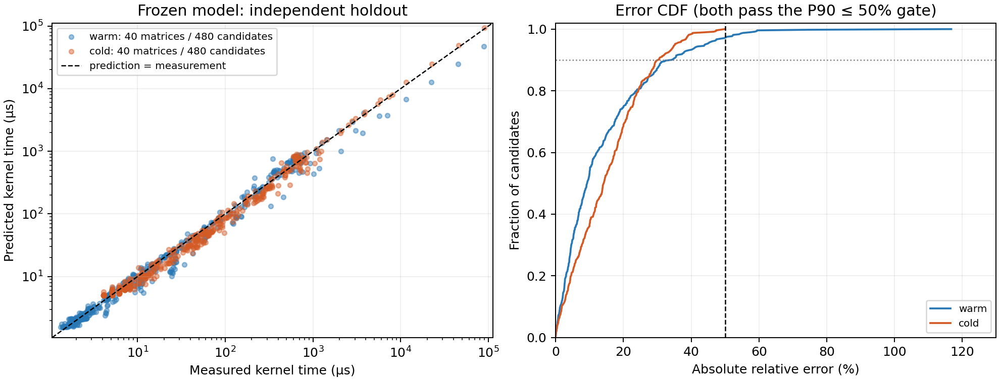
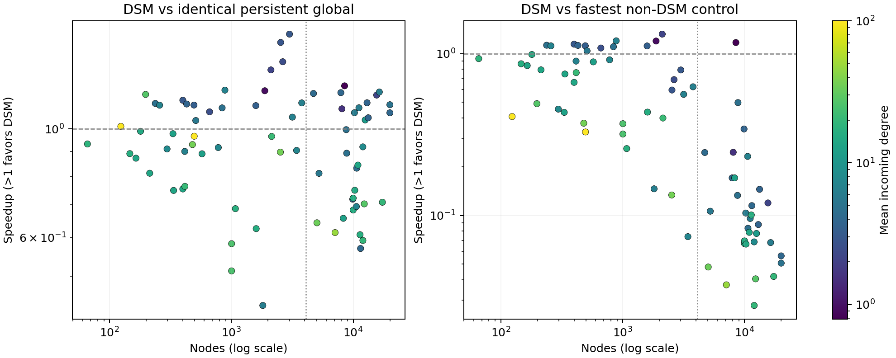
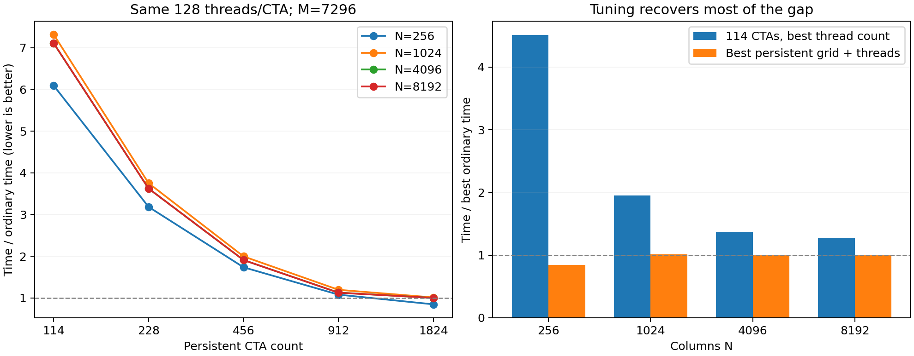
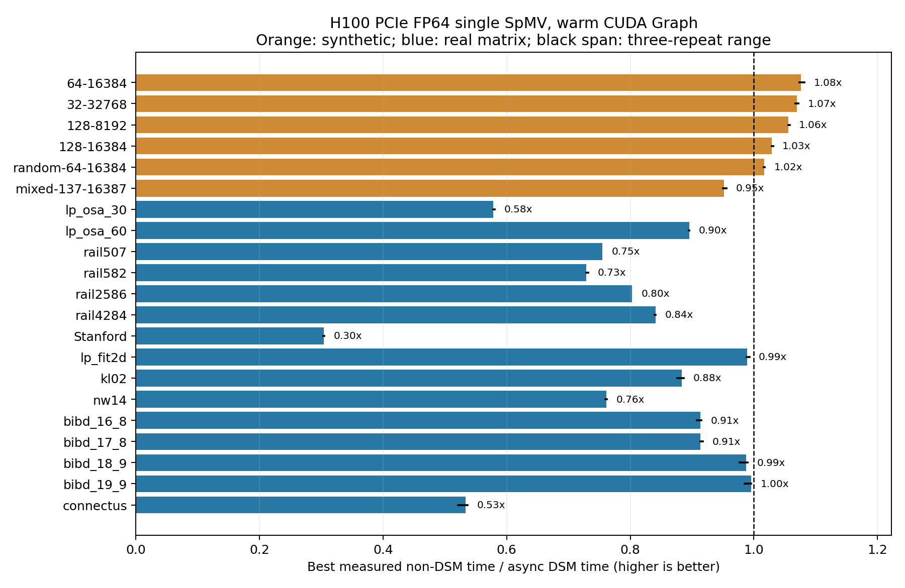
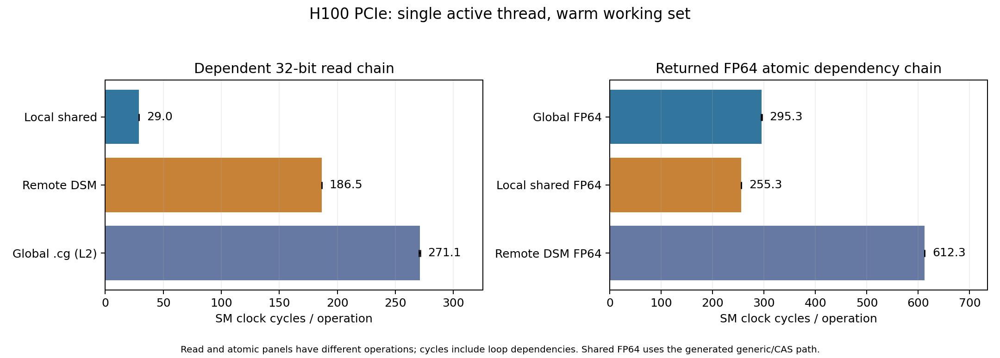
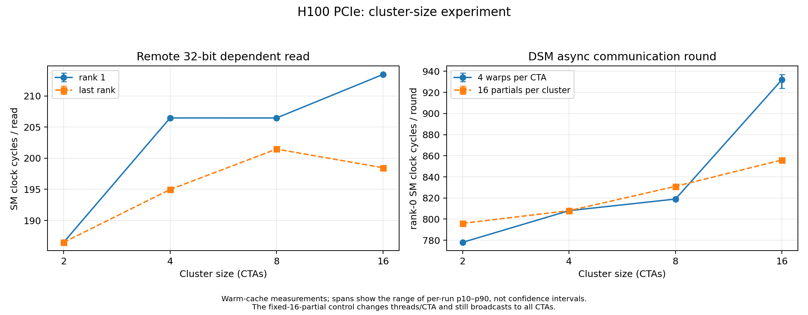

# AtSpMV 性能预测模型 v2

DSMEM 相关工作的研究动机、参考实现与性能概览见[分布式共享内存优化背景](dsmem-background.md)。

当前模型预测给定矩阵在 **6 种 tile shape × 普通/均衡两种调度模式** 下的 GPU
SpMV 计算时间，并选择最小值。它综合使用 SM 数、具体内核 occupancy、tile 工作量、
最长任务、缓存容量和原子更新开销。运行时只使用矩阵统计和 GPU 属性，**不会先运行
待预测矩阵的候选内核**；参数在独立训练矩阵上离线校准。

RTX 5880 Ada 已内置预热与冷缓存两套校准参数。其他硬件几何使用未校准默认值，
不能声称达到下面的误差。当前没有 H100 校准结果。

新增的 cap、block 大小、预取与 CTA 归约选项属于实验配置，默认保持旧内核。
以下准确率仅适用于默认配置；实验方法与结果见文末“可配置内核实验”。

## 已验证的准确性

预先固定清单中的 242 个矩阵，161 个有效训练矩阵、40 个开发矩阵、40 个最终留出矩阵。
一个训练文件 `nlpkkt80` 在解析时失败，未参加拟合。留出集中的 `inline_1` 本地文件和
压缩包被截断，已从官方 UF 镜像恢复同一矩阵；保留原始文件及恢复来源、哈希。

每个矩阵测量全部 12 个候选。两种缓存状态各有 **480 条独立留出测量**。
模型冻结后，更换候选随机顺序再独立复测一次；两次留出结果均未用于拟合。
事先设定的门槛是 **MAPE ≤ 30%，候选相对误差的 P90 ≤ 50%**。

| 场景 | 平均绝对相对误差 MAPE | 相对误差中位数 | 相对误差 P90 | 最大误差 |
| --- | ---: | ---: | ---: | ---: |
| 预热，第一次留出测试 | 14.15% | 9.31% | 34.16% | 116.74% |
| 预热，独立复测 | 13.98% | 9.34% | 32.69% | 127.44% |
| 冷缓存，第一次留出测试 | 15.40% | 14.21% | 30.23% | 49.82% |
| 冷缓存，独立复测 | 12.14% | 9.91% | 26.19% | 78.62% |

这说明典型误差已明显改善，但**不保证每个候选都在 50% 内**。例如预热场景的
`degme`、32×1 均衡候选仍明显高估。完整报告保留最大误差和最差候选，未删掉异常点。

预热首次验证中，六种 shape 的 MAPE 约 11%–18%，按矩阵 nnz 数量级分组也提供了结果。
选型损失定义为 `T(预测选中) / min(T(12个候选)) - 1`；首次预热验证的中位数为
0.52%、P90 为 21.36%，冷缓存分别为 0.76%、28.26%。这项指标与绝对时间误差分别统计。



数据与报告：

- [验证汇总](../results/model/v2-validation-summary.json)
- [预热留出报告](../results/model/v2-warm-holdout.json)及 [CSV](../results/model/v2-warm-holdout.csv)
- [冷缓存留出报告](../results/model/v2-cold-holdout.json)及 [CSV](../results/model/v2-cold-holdout.csv)
- [预热复测](../results/model/v2-warm-repeat.json)、[冷缓存复测](../results/model/v2-cold-repeat.json)
- [冻结的矩阵划分](../results/model/suite-v2-manifest.json)、[输入恢复记录](../results/model/input-recovery.json)

## 单个 SM 处理 N 个 tile

一个 tile 有 32 个槽位，形状为 `m×k`，其中 `m*k=32`。
GPU 对排序后的行长做一次统计，得到每种 shape 的总 tile 数 `B`、拆分任务数
`W_split` 和最长行组 tile 数 `L_max`。统计计数采用 64 位；实际打包内核仍使用
32 位偏移，超出其容量的候选会被拒绝。

普通模式 `W=ceil(nrows/m)`，均衡模式 `W=W_split`，默认每个均衡任务最多 8 个 tile。
默认 kernel 每个 CUDA block 为 4 个 warp；设 GPU 有 `S` 个 SM：

```text
S_active = min(S, ceil(W/4))
N        = B / S_active
W_SM     = W / S_active
C        = min(实际 kernel 的驻留 warp 数, W_SM)
L_task   = L_max              # 普通模式
           min(L_max, 8)      # 均衡模式
```

驻留 warp 数由 `cudaOccupancyMaxActiveBlocksPerMultiprocessor` 对具体 shape、模式、
索引宽度查询。所有硬件属性取当前 CUDA device，不固定 device 0。

模型输出（除最终输出外，以下时间单位均为 ns）：

```text
T_issue = [N × max(c_tile, 32/FP64_lanes_per_cycle)
           + W_SM × (c_setup + log2(k) × c_shuffle)] / clock_cycles_per_ns

T_dependency = max(N/C, L_task) × tile_latency[m]

T_atomic = a_avg × W*m/S_active
           + a_serial × ceil(L_max/8)*m/32       # 仅均衡模式

T_predict = T_fixed + max(T_memory, T_issue, T_dependency) + T_atomic
```

这使模型能区分相同总 tile 数下的不同任务分布：少数长任务受 `L_task` 限制；拆分后
长尾缩短，但任务数和原子竞争增加。`a_avg` 表示分摊到 SM 的原子服务成本，`a_serial`
近似同一行组反复写回的竞争。`T_fixed` 是拟合得到的固定成本，不应直接解释成纯 CPU
launch 开销。

## 缓存模型

预热计算中，仅使用理论 DRAM 带宽会大幅高估时间。v2 以打包后矩阵和向量工作集估计
缓存容量过渡：

```text
F = 32*B*(8 + index_bytes) + 8*(nrows+ncols)
r = F / L2_capacity
q = sigmoid(gamma*(r-theta))           # 预热模式的有效 DRAM 服务比例
q = 1                                # 冷缓存模式

D = 32*B*(8 + index_bytes) + 8*nnz
    + W*(balanced ? 12 : 8) + 12*nrows

occupancy_factor = min(1, C/saturation_warps)
T_memory = D / BW_peak
           × [q/DRAM_efficiency + (1-q)/L2_multiplier]
           × S/S_active / occupancy_factor
```

`BW_peak` 的单位为 bytes/ns，数值等于 GB/s。读取量包括值、索引、x 访问及元数据。
矩阵 padding 计入存储；x 访问按真实 nnz 估计。随机列访问的事务放大和跨行复用没有
逐地址模拟，而由有效服务系数吸收。

`q` 是拟合的有效比例，**不是测得的 cache miss rate**。L2 系数也不是实际 L2 峰值带宽：
它与指令项存在可辨识性限制，部分训练场景由其他项主导。不要将这些拟合系数当作
硬件微基准测量结果。当前模型近似 SM 平均分工和最长任务，没有精确模拟 CUDA block
派发、warp 调度器、内存分区或 DVFS。

## 校准与数据隔离

模型对每个缓存状态使用一组共享的少量系数（预热最多 17 个；冷缓存不使用三个缓存
过渡系数），没有矩阵名称、矩阵 ID、测量结果或每矩阵自由参数作为预测输入。
离线通过 SciPy `least_squares`，最小化预测/实测时间比值的对数残差，使用 `soft_l1`
稳健损失和参数边界。

清单先固定，再采样。矩阵名称首个数字前的前缀用于近似家族分组，每个近似家族只抽
一个矩阵，再按 nnz 数量级分层分配训练/开发/测试。**这只是名称启发式，不保证官方
数据来源或图数据的语义完全独立**。不同 shape 的同一矩阵不会跨训练和测试集合。
开发集用于检查模型，测试集没有参与拟合；所有候选都纳入误差统计。

[预热参数](../models/rtx5880-ada-v2.json)和[冷缓存参数](../models/rtx5880-ada-v2-cold.json)
保存硬件几何、划分文件哈希、训练矩阵、开发矩阵及拟合版本。
`export_time_model.py` 将参数生成为 `include/tileModelCalibration.h`，运行时无 Python
依赖。只有 SM 数、计算能力、L2 大小和 FP64 lane 估计匹配时才标记为已校准。
修改环境变量覆盖参数后，`calibrated` 标志会清除。

## 测量与数值验证

环境：RTX 5880 Ada，110 SM、96 MiB L2，CUDA 12.4，驱动 580.178.04，SM80 编译后在
SM89 上运行。未锁定 GPU 时钟。H100 当时已有任务和大量显存占用，未进行校准。

- 预热：预热后以 CUDA Graph 批量重放 kernel，动态限制批次长度，取九批平均单次时间
  的中位数；避免 CPU launch 间隙影响微秒级计算。
- 冷缓存：每次在同一 stream 上先读取/写入超过两倍 L2 的驱逐缓冲区，再计时单次
  kernel。驱逐不计入预测目标。它是受控的冷缓存近似，不承诺所有 cache line 都失效。
- 候选顺序由固定种子打乱，独立复测更换种子。原始表保留批次 P10/P90 和 graph 节点数。
- 计时传入 `beta=1`，仅包含计算 kernel；均衡输出可跨重复累加。数值正确性单独使用
  `beta=0`，先把输出填为 NaN，确保初始化、空行及全部候选正确。
- CPU 参考使用 `long double` 累加。逐行误差界为
  `8*epsilon_double*(row_nnz+32)*sum(abs(a*x)) + 1e-12`，避免强消去时错误地把相对
  最终结果的微小差值判成算法错误。全部有效矩阵最大归一化误差约 `2.62e-14`。

每种缓存状态的 241 个有效矩阵、全部 12 个候选均通过数值检查（共 5784 组），另有
留出复测及主机入口回归。主机入口回归和小矩阵通过 compute-sanitizer memcheck。
Python 与 C++ 在全部留出候选上的预测相对差异小于 `1e-12`。

计时仍有误差：两次独立测量间，预热耗时变化的中位数约 0.47%、P90 约 8.96%；冷缓存
约 8.95% 和 19.36%。冷缓存的单次微秒级计时对 event 粒度、时钟及驱逐状态较敏感。
因此不能把候选间百分之几的差异当成稳定优势，也不能把开发集经验误差带称为保证覆盖
的置信区间。

## 使用

```bash
cmake -S . -B build -DCMAKE_BUILD_TYPE=Release
cmake --build build --parallel
ctest --test-dir build --output-on-failure
CUDA_VISIBLE_DEVICES=0 ./build/spmv_regression

mkdir -p artifacts
# 默认预热模型；查看所有预测分项
CUDA_VISIBLE_DEVICES=0 ATSPMV_MODEL_TRACE=1 \
  ./build/tile_model_bench path/to/matrix.mtx > artifacts/warm.csv

# 冷缓存测量自动选择冷缓存模型，也可在应用中单独设置 MODEL_CACHE=cold
CUDA_VISIBLE_DEVICES=0 ATSPMV_BENCH_CACHE=cold \
  ./build/tile_model_bench path/to/matrix.mtx > artifacts/cold.csv

# 不用 GPU，直接在特征表上检查内置 C++ 预测
./build/tile_model_predict results/model/v2-warm-holdout.csv
```

`AtBsr.predictedTimeUs` 保存选中方案的预测值。`ATSPMV_MODEL_CACHE=warm|cold` 选择应用
预期的缓存状态；默认 warm。`ATSPMV_MODEL_TRACE=1` 输出校准标志和全部 12 候选分项。
现有参数覆盖变量保留，新增 `ATSPMV_MODEL_L2_MULTIPLIER`、`ATSPMV_MODEL_CACHE_FRACTION`、
`ATSPMV_MODEL_CACHE_TRANSITION`、`ATSPMV_MODEL_ATOMIC_SERIAL_NS`；详细字段见
`modelParametersFromEnvironment`。一般应重新拟合完整硬件配置，而非随意调整单个系数。

预测目标是计算 kernel，不包含排序、转换、PCIe、额外 beta/清零 kernel 和 CPU 行序恢复。
校准测量使用 Product 路径；主机 `Spmv` 入口共用该模型做选型，但其原有同步/清零计时
不能直接与预测值比较。当前内核是普通 FP64 + shuffle，未使用 Tensor Core MMA。

## 重现采样、拟合和评估

```bash
# 在新 GPU 上采样训练和开发集，先选择空闲设备；路径按本机调整
python scripts/analysis/collect_model_data.py \
  --manifest results/model/suite-v2-manifest.json \
  --binary build/tile_model_bench --output artifacts/new-gpu-warm \
  --splits train dev --devices 0

python scripts/analysis/fit_time_model.py \
  --manifest results/model/suite-v2-manifest.json --data artifacts/new-gpu-warm \
  --output artifacts/new-gpu-warm-profile.json

# 冻结参数后采样 test；冷缓存流程另用 --cache cold 和单独输出目录
python scripts/analysis/collect_model_data.py \
  --manifest results/model/suite-v2-manifest.json \
  --binary build/tile_model_bench --output artifacts/new-gpu-warm \
  --splits test --devices 0
python scripts/analysis/evaluate_time_model.py \
  --manifest results/model/suite-v2-manifest.json --data artifacts/new-gpu-warm \
  --profile artifacts/new-gpu-warm-profile.json --output artifacts/new-gpu-holdout.json

# 当前已验证配置的 C++ 导出；更换 profile 后重新编译
python scripts/analysis/export_time_model.py models/rtx5880-ada-v2.json \
  include/tileModelCalibration.h --cold models/rtx5880-ada-v2-cold.json
MPLBACKEND=Agg python scripts/analysis/plot_time_model_validation.py
```

清单路径指向本机 SuiteSparse 库，移植时需提供对应路径；已有损坏输入恢复可通过
`--overrides results/model/input-recovery.json` 使用，恢复文件放在本地忽略的 `data/` 中。
采样器保存失败原因，不以失败候选的剩余部分冒充完整结果。输出目录会跳过已成功矩阵，
复测时必须使用新目录并指定新 `--seed`。

参考：NVIDIA [Occupancy API](https://developer.nvidia.com/blog/cuda-pro-tip-occupancy-api-simplifies-launch-configuration)
与 [CUDA Best Practices Guide](https://docs.nvidia.com/cuda/cuda-c-best-practices-guide/index.html)。
本文公式及校准方法为本项目的近似模型，不是 NVIDIA 提供的精确硬件时序模型。


## 可配置内核实验

本轮实现聚焦普通 CUDA FP64 SpMV，不需要 PDL、Tensor Core 或 thread-block cluster。
`Spmv` 主机接口与 `CSRToAtBSRProduct` / `AtSpmvProduct` 设备接口均可使用以下配置。
配置在转换时读取并存入 `AtBsr.kernelConfig`，之后修改环境变量不会改变已经打包的矩阵。
不要直接修改已转换矩阵的配置，特别是 cap，它决定任务指针的布局。

| 环境变量 | 可选值 | 默认值 | 含义 |
| --- | --- | --- | --- |
| `ATSPMV_TUNE_CAP` | 4、8、16、32 | 8 | 每个均衡任务最多处理的 tile 数 |
| `ATSPMV_TUNE_WARPS` | 2、4、8 | 4 | 每个 CTA 的 warp 数 |
| `ATSPMV_TUNE_PREFETCH` | 0、1、2、4、8 | 0 | 0 使用原内核；其他值使用批量独立加载与累加的新内核 |
| `ATSPMV_TUNE_CTA_REDUCE` | 0、1 | 0 | 均衡模式是否在 CTA 内合并同一行的部分和 |

预取版本先加载一批 tile 的索引和数值，再发起独立的 `x[col]` 读取，并使用多个累加器。
这是增加指令级并行的批处理，不是 `cp.async`，也不保证编译器生成跨批次双缓冲流水线。
深度增大可能增加寄存器占用或降低吞吐，因此必须实测。深度 1 用于隔离新内核结构本身的影响。

CTA 归约利用同一行组的任务连续排列这一性质，通过共享内存合并当前 CTA 内的部分和，
由每一段的首个 warp 发起原子加。跨 CTA 的部分和仍用全局原子操作；不同组不会混合。
末尾无效 warp 也参与 CTA 同步，防止部分 block 的同步错误。
`PREFETCH=0, CTA_REDUCE=1` 在均衡模式使用深度 1 的归约内核，普通模式继续使用原内核。

另一个默认生效的优化：普通模式 `beta=0` 时，内核覆盖全部输出行，包括空行，
因此移除了之前冗余的输出清零 kernel；均衡模式与空矩阵处理仍保留必要的初始化。
这减少一次启动和一次输出写入，不改变下面仅计 SpMV kernel 的测量口径。

### 模型边界

统计与模型已使用配置中的 cap 和 block 大小，occupancy 查询对应的实际内核、索引类型和
block 大小。所有非默认配置的 `AtBsr.modelCalibrated` 和 CSV `model_calibrated` 均为 false。
依赖延迟系数仍来自旧内核，原子成本尚未扣除 CTA 合并节省的更新次数，也没有拟合预取的
ILP 收益及共享内存同步开销。因此新配置的预测只属于旧模型外推，不能引用 v2 的误差报告。

运行时仍只在指定配置下选择 12 个 tile/mode 候选，**不会自动搜索 120 个配置，也不会试跑
目标矩阵**。离线 sweep 用于对照实验。v2 拟合与评估入口会拒绝包含非默认配置的数据，
避免把新内核测量误用于旧公式。原有模型参数文件保持不变。

### 重现

```bash
# 只启用 CTA 内归约；默认 cap 和 block 大小保持不变
CUDA_VISIBLE_DEVICES=0 ATSPMV_TUNE_CTA_REDUCE=1 \
  ./build/tile_model_bench --synthetic 100

# 全部 120 个配置 × 8 个合成输入 × 12 个 tile/mode 候选
CUDA_VISIBLE_DEVICES=0 python3 scripts/analysis/sweep_kernel_configs.py \
  --binary build/tile_model_bench --full \
  --output artifacts/kernel-sweep-synthetic.csv

# 8 个开发集矩阵上的 8 组配置（含基线），不使用最终留出集选配置
CUDA_VISIBLE_DEVICES=0 python3 scripts/analysis/sweep_kernel_configs.py \
  --binary build/tile_model_bench --configs results/model/kernel-dev-configs.json \
  --manifest results/model/suite-v2-manifest.json \
  --names appu Wordnet3 roadNet-PA trdheim exdata_1 cant cnr-2000 la2010 \
  --output artifacts/kernel-sweep-dev.csv

cmake -S . -B build -DATSPMV_ENABLE_GPU_TESTS=ON
cmake --build build -j
CUDA_VISIBLE_DEVICES=0 ctest --test-dir build --output-on-failure
```

Sweep 随机化配置/矩阵执行顺序，保留每个候选的正确性结果、9 批次中位时间与 P10/P90。
每次配置测量都验证两次连续 `beta=0` 调用后的结果，使用 long double CPU 参考及按
`sum(abs(a*x))` 缩放的误差界。计时仍为 CUDA Graph 内 `beta=1` 的 kernel 时间，
不包含转换、清零或 CPU 启动间隙，不是应用端到端加速比。

JSON 汇总固定旧模型选中的 tile 与模式，对比 `T_baseline / T_config`，大于 1 表示更快。
它不是每个矩阵事后挑选的 oracle 加速比。空矩阵只参加正确性检查，不参与加速比汇总。
合成输入用于覆盖边界，8 个开发矩阵是有限样本，均不构成独立留出集性能保证。


### 本轮实测与默认配置决策

编译使用 CUDA 12.4、Release、SM80；运行设备为两张空闲 RTX 5880 Ada，驱动 580.178.04。
H100 当时被其他任务占用，未测试。8 个真实矩阵来自既有 dev 划分，未使用 test 划分调参。

固定旧模型选择后，8 个开发矩阵的加速比几何平均如下；复测更换了执行顺序种子。

| 配置（cap / warps / prefetch / CTA reduce） | 首次 | 复测 |
| --- | ---: | ---: |
| 8 / 4 / 0 / 0，基线 | 1.000× | 1.000× |
| 8 / 4 / 0 / 1，只合并 CTA 内部分和 | 0.982× | 0.970× |
| 8 / 4 / 2 / 0，两级预取 | 0.947× | 0.951× |

合成 `long_tail` 的 2×16 均衡候选，CTA 归约使预热 kernel 时间从 4.925 μs 降到
4.383 μs（1.124×）；独立复测从 4.803 μs 降到 4.301 μs（1.117×）。
但它在其他输入会增加同步开销，冷缓存长尾测试也未保持收益。两级预取在小输入有收益，
在部分较大输入反而明显变慢。部分未改变内核的测量也存在波动，不能把几个百分点的差异
视为确定加速。

因此 **默认保持 cap=8、4 warps、旧内核、不开启 CTA 合并**，只默认启用普通模式的
冗余清零删除。新选项和完整测量保留用于目标工作负载实验；没有宣称全数据集整体加速，
没有根据合成数据改写运行时默认选择或重新拟合参数。

验证汇总：120×8×12 = 11,520 条全量合成候选；真实 dev 首测 768 条、复测 288 条；
合成复测与冷缓存各 288 条，共 **13,152 条候选正确性检查全部通过**。另外 6 项 CTest
通过；最大预取深度、8-warps CTA 归约版本经 Compute Sanitizer memcheck 为 0 errors，
racecheck 为 0 hazards / 0 warnings。检查覆盖空行、部分 tile、部分 CTA、16/32 位索引、
跨 CTA 的长行和连续重复调用。旧版 v2 拟合入口的非默认配置拒绝检查也通过。

- [验证汇总](../results/model/kernel-tuning-validation.json)
- [全量合成扫描](../results/model/kernel-sweep-synthetic.json) / [CSV](../results/model/kernel-sweep-synthetic.csv)
- [开发集扫描](../results/model/kernel-sweep-dev.json) / [CSV](../results/model/kernel-sweep-dev.csv)
- [开发集复测](../results/model/kernel-sweep-dev-repeat.json) / [CSV](../results/model/kernel-sweep-dev-repeat.csv)
- [合成复测](../results/model/kernel-sweep-synthetic-repeat.json) / [冷缓存检查](../results/model/kernel-sweep-synthetic-cold.json)

复测使用 `--configs results/model/kernel-repeat-configs.json --seed 20261029`；冷缓存使用
同一配置清单和 `--cache cold`，不添加真实矩阵参数则默认运行合成输入。


## 完整 x 的分布式共享内存实验（SM90）

新增独立的 `atspmv_dsm` 实验库，默认不构建、不接入自动选型。实现见
[`dsmSpmv.cu`](../src/dsmSpmv.cu)，接口见 [`dsmSpmv.h`](../include/dsmSpmv.h)。
本轮按要求**只测试正确性，不采集或推断性能结果**；H100 当时仍在运行其他任务。

### 存储与任务分配

一个大小为 `C` 的 cluster 保存一份完整 `x`，将它按列号循环分片到 C 个 CTA：

```text
owner(col) = col & (C - 1)       # C = 1 / 2 / 4 / 8
local(col) = col / C
shared_x[local(col)] = x[col]   # 由 owner CTA 初始化
```

每个 CTA 分配 `ceil(ncols/C) * sizeof(double)` 动态共享内存。SpMV 使用
`cluster.map_shared_rank(shared_x, owner)` 得到对应分片，再读取 `local(col)`。
C 是模板常量，因此 owner/offset 可用掩码和移位计算。C=1 是本地共享内存对照；
C>1 会使用 DSM。每个 cluster 都有自己的完整副本，**不能把全 GPU 的共享内存当成
一个任意访问的全局共享池**。

初始化后的 `cluster.sync()` 保证所有分片可读，退出前再同步，保证较早完成的 CTA
不会释放其他 CTA 仍在读取的共享内存。即使某个 CTA 没有 SpMV 任务，也要完成加载并
参与这两个同步。网格按 cluster 对齐，使用 grid-stride warp 任务分配，让每次加载的 x
可以服务多批任务；默认网格大小受 `cudaOccupancyMaxActiveClusters` 限制。

每次调用都会重新加载 x，包括 CUDA Graph 每次重放。没有假设迭代之间 x 不变。
接口只提供 `y=A*x`：均衡模式先清零输出，普通模式直接覆盖，空矩阵输出零。
x/y 不允许别名；矩阵必须在 plan 存续期间保持有效且不被修改。

准备 plan 时按当前设备 `cudaDevAttrMaxSharedMemoryPerBlockOptin` 与实际内核静态共享内存
检查容量，并显式 opt-in 动态共享内存。完整 x 放不下就报错，**不偷偷截断或回退到 global**。
8-CTA 正确性用例已覆盖 200,003 个 double（1,600,024 字节）的 x；容量上限以上的输入
则验证拒绝。大矩阵的 x 若超过 cluster 总容量，这个“全部放共享内存”方案不适用，
需要另外研究分块列空间或仅缓存热点 x 元素。

另有 `XStorage::Global` 对照：使用同一套 cluster launch、warp 任务分配和标量累加方式，
直接读取 global x，便于之后隔离存储方式的影响。它同样要求支持 cluster 的 GPU。
该实验允许改变打包 cap、warps/block，但暂不叠加预取或 CTA 部分和归约，以控制比较变量。
模型参数没有为 DSM 拟合，原有 `predictedTimeUs` 不代表 DSM 时间。

### 构建与调用

需要 CUDA 12+；DSM 库与测试单独编译为 SM90，原库仍可保留原来的架构配置。

```bash
cmake -S . -B build-dsm \
  -DCMAKE_BUILD_TYPE=Release \
  -DCMAKE_CXX_COMPILER=/usr/bin/g++ \
  -DCMAKE_CUDA_HOST_COMPILER=/usr/bin/g++ \
  -DATSPMV_BUILD_DSM_EXPERIMENT=ON -DATSPMV_ENABLE_GPU_TESTS=ON
cmake --build build-dsm --target dsm_spmv_test -j

# 只做正确性检查，不包含 timing loop
CUDA_VISIBLE_DEVICES=2 ./build-dsm/dsm_spmv_test
CUDA_VISIBLE_DEVICES=2 ctest --test-dir build-dsm -R '^dsm_spmv_correctness$' --output-on-failure

# 缩小用例集合进行工具检查
CUDA_VISIBLE_DEVICES=2 compute-sanitizer --tool memcheck --error-exitcode 99 \
  ./build-dsm/dsm_spmv_test --quick
CUDA_VISIBLE_DEVICES=2 compute-sanitizer --tool racecheck --error-exitcode 99 \
  ./build-dsm/dsm_spmv_test --quick
```

链接 `atspmv_dsm` 后，在已有设备矩阵上调用：

```cpp
#include "dsmSpmv.h"
// a 由 CSRToAtBSRProduct 生成，prefetch=0、cta_reduce=0。
// plan 在 capture 外准备；a 在 plan 使用期间不得释放、移动或修改。
auto plan = atspmv::makeDsmSpmvPlan(a, 8, atspmv::XStorage::DistributedShared);
atspmv::launchDsmSpmv(plan, d_x, d_y, stream);
// plan.sharedBytesPerBlock(), plan.gridBlocks(), plan.activeClusters()
// 可供后续性能实验记录资源配置。
```

### 已完成的正确性验证

CUDA 12.4 / SM90，H100 PCIe：704 项直接调用检查、176 项 CUDA Graph 检查通过。
每项直接检查包含连续两次覆盖写；另以不同 x 再调用同一 plan，验证没有使用旧向量。
结果逐行对照 long double CPU 参考，误差界沿用前面的按绝对乘积和缩放规则。

覆盖全部六种 tile shape、普通/均衡模式、16/32 位列索引、1/2/4/8-CTA cluster、
跨分片列号、空行、零行矩阵、部分 CTA、长行、多 cluster、强制小网格的多轮任务、
不同 cap/warps 和大 x。无 cluster 支持的 RTX 5880 路径正确返回 CTest skip，未尝试启动
SM90 内核。超容量 x 和非法 cluster 大小均被拒绝。

精简集合中 144 项直接检查、36 项 Graph 检查又通过 Compute Sanitizer memcheck
（0 errors）、racecheck（0 hazards / 0 errors / 0 warnings）和 synccheck（0 errors）。
验证记录见 [DSM 正确性汇总](../results/model/dsm-correctness-validation.json)。

### H100 性能结果：单次 SpMV 没有收益

在空闲的 H100 PCIe（GPU 3，PCI D6:00.0）上，`dsm_spmv_bench` 已比较原内核、
cluster global、本地 shared、DSM 和 cuSPARSE。计时包含完整 x 搬运、cluster 同步、
计算，以及均衡模式的清零。采用 warm CUDA Graph 重复调用；这不是 cold-HBM 测试。

六个能容纳完整 x 的真实矩阵中均未观察到 DSM 加速，例如 appu 的原内核约 9.58 μs，
最佳 DSM 约 31.21 μs；exdata_1 为 8.01 μs 对 14.89 μs。cnr-2000 超出实验的
完整 x 容量，DSM 候选跳过。原始数据与汇总见
[`dsm-screen`](../results/model/dsm-screen/summary.json)。因此不将该路径加入默认选择器。
每次启动的逻辑 x 加载量仍为 `cluster_count * ncols * 8`，并非全 GPU 只加载一次。

相关语义以 NVIDIA [CUDA 12.4 Distributed Shared Memory 文档](https://docs.nvidia.com/cuda/archive/12.4.1/cuda-c-programming-guide/index.html#distributed-shared-memory)
为依据，特别是访问前保证 CTA 已启动、退出前保证远程访问已完成这两个生命周期要求。


## 持久化 PageRank 的 DSM 实验

单次 SpMV 难以摊薄搬运开销，因此新增独立、显式启用的持久化 PageRank 路径：
[`dsmPageRank.h`](../include/dsmPageRank.h)、[`dsmPageRank.cu`](../src/dsmPageRank.cu)。
它计算输入图的无权有向 PageRank：先按出度归一化并转置 CSR，迭代中包含阻尼、
均匀 teleport 和 dangling mass 重分配。原始矩阵数值不作为边权；固定迭代次数，
不包含提前收敛检测。它不是原有单次 SpMV 接口的透明替换。

实现使用一个 cluster，按 `owner = index % C`、`offset = index / C` 循环分片存储
两份 rank 向量。初始向量只搬运一次，所有迭代在一个 kernel 中完成，最后写回结果。
每 4 个线程处理一行；小图路径将每线程每行前 8 个非零项保留在寄存器，剩余长行
仍完整遍历 CSR。较大图回退到循环遍历路径。每轮通过 cluster barrier 保护双缓冲交换，
存在 dangling 节点时另做 cluster 归约。缓存的 DSM 地址使用 `mapa.shared::cluster`，
读取使用 `ld.shared::cluster.f64`。全局内存对照复用相同分行、缓存和同步结构。

### 实测范围与对照

固定 C=8，H100 PCIe，FP64，阻尼 0.85，100 次迭代。以下为三个独立随机测量顺序下，
各次运行中位数的中位数，单位 μs。每次运行有 3 批预热、15 批测量，各候选交错执行。
CUDA event 包围完整 solve 的 CUDA Graph，包含初始向量加载与最终输出；图构建、
归一化转置、plan 创建和内存分配不计入。plan 创建时间另列于 CSV 的 `setup_us`。
结果代表已建立图和 plan 后的热运行时间，不代表一次性命令行总耗时。

| 图 | DSM C=8 | 最快持久化 global（C=1/2/4/8） | 最快逐轮融合 CSR Graph（1/4/32 线程每行） | cuSPARSE Graph |
|---|---:|---:|---:|---:|
| netscience | 376.54 | 419.71 | 603.49 | 897.15 |
| NotreDame_yeast | 492.51 | 650.40 | 672.19 | 980.26 |
| odepa400 | 100.74 | 115.23 | 175.65 | 474.69 |
| sphere3 | 100.32 | 111.97 | 189.98 | 454.40 |
| lund_a | 124.80 | 108.16 | 188.26 | 465.31 |
| soc-sign-bitcoin-alpha | 1614.14 | 1822.66 | 1007.36 | 1244.74 |
| rbsb480 | 775.33 | 711.20 | 288.45 | 478.05 |
| email-Eu-core | 1593.76 | 928.70 | 589.02 | 776.19 |

netscience 用于开发后的独立重复验证；其余七个图在冻结内核后测量，未据此调参。
在真实网络图 NotreDame_yeast 上，相比最快持久化 global，DSM 加速约 **1.32×**，
相比最快逐轮融合 Graph 约 **1.36×**。netscience 分别约 **1.11×** 和 **1.60×**。
这把“迭代融合”的收益与 DSM 自身的增量区分开来。C=1 本地 shared 对照也包括在 CSV 中。

反例同样保留：bitcoin-alpha 虽比持久化 global 快，仍比逐轮 Graph 慢；
lund_a 的最佳实现是持久化 global；email-Eu-core 与 rbsb480 不适用。
单个 cluster 只利用部分 SM，大图或高不均衡图容易受并行度、远程访问延迟与寄存器压力限制。
因此没有增加默认自动派发规则，也不能据此声称 DSM 普遍优于 L2，或普通 SpMV 已获加速。

原始复测：[netscience](../results/model/dsm-pagerank-repeat/metadata.json)、
[冻结后的七图验证](../results/model/dsm-pagerank-holdout/summary.json)。后者 metadata 记录
源文件、可执行文件与数据集 SHA256、GPU UUID 和运行参数。
早期 `dsm-pagerank-screen`、`dsm-pagerank-cached` 是探索数据，不应混用为当前版本结果。
最终构建产物另用三个新随机顺序复测两个主要网络图，收益仍成立：
[最终二进制复测](../results/model/dsm-pagerank-final/summary.json)、
[验证汇总](../results/model/dsm-pagerank-validation/summary.json)。

另用三个新随机顺序测量 1/10/100 轮，结果见
[迭代次数复测](../results/model/dsm-pagerank-iterations/summary.json)。NotreDame_yeast
单轮 DSM 约 12.83 μs，慢于逐轮 Graph 的 11.65 μs；10 轮为 56.35 μs 对 71.36 μs，
100 轮为 492.45 μs 对 672.77 μs。这支持跨迭代摊薄开销的解释，不支持单次 SpMV 加速的结论。

### 复现与正确性

使用上文 DSM 构建配置，并构建 `dsm_pagerank_bench`。例如：

```bash
CUDA_VISIBLE_DEVICES=3 python3 scripts/analysis/benchmark_dsm_pagerank.py \
  --exe /tmp/atspmv-dsm-sm90-build/dsm_pagerank_bench \
  --output /tmp/dsm-pagerank-repeat \
  --seeds 20261105 20261106 20261107 -- \
  /path/to/netscience.mtx /path/to/NotreDame_yeast.mtx

CUDA_VISIBLE_DEVICES=3 ctest --test-dir /tmp/atspmv-dsm-sm90-build \
  -R dsm_pagerank --output-on-failure

CUDA_VISIBLE_DEVICES=3 compute-sanitizer --tool racecheck --error-exitcode 9 \
  /tmp/atspmv-dsm-sm90-build/dsm_pagerank_bench \
  --synthetic:513 7 20261104 --check-only
```

基准的每个候选均与 CPU long double 参考对比，并检查有限性、非负性及概率质量；
绝对误差阈值为 1e-11，质量误差阈值为 1e-10。直接调用和 Graph 调用分别验证。
额外的 9 种尺寸 × 4 种迭代数（0/1/2/7）覆盖非均匀初始向量、悬挂节点、长行、
缓存与非缓存路径，以及 CTA 分片尾部。36 组 × 12 个候选均通过；当前内核通过
memcheck、racecheck、synccheck。日志见
[`dsm-pagerank-validation`](../results/model/dsm-pagerank-validation/correctness.json)。

库接口示例（`a_transpose` 已在 GPU 上完成出度归一化和转置）：

```cpp
#include "dsmPageRank.h"
auto plan = atspmv::makePersistentPageRankPlan(
    a_transpose, d_dangling_mask, has_dangling, 8,
    atspmv::XStorage::DistributedShared);
atspmv::launchPersistentPageRank(plan, d_initial, d_rank, 100, 0.85, stream);
```

调用方应复用 plan，保持 CSR 与 mask 在同一设备上有效直至计算完成。
全局内存对照 plan 拥有可复用工作区，同一个 plan 不可跨 stream 并发复用。
DSM 容量包括两份向量和归约空间，超容量会拒绝创建；这不是任意大小图的通用求解器。

### 扩展到 74 个矩阵后的适用范围

按预先确定的规则，从既有 manifest 选择全部方阵、`0 < n <= 20000`、文件非零元
不超过 300000 的矩阵，共 74 个；固定当前内核、C=8、100 次迭代，每个矩阵使用
三个测量顺序种子，共 222 次完整基准运行。集合既包括真实网络，也包括从其他应用
矩阵结构派生的无权图，不能视作 74 个天然 PageRank 应用。此轮是扩展描述性评估，
与之前使用的数据有重叠，不是新的独立 holdout。

所有 2649 条候选结果均通过直接调用和 Graph 的 CPU 参考检查，最大绝对误差
2.50e-16；分析脚本另检查了两种读取器展开对称矩阵后的节点数与条目数一致。
“稳定收益”定义为三次运行均快至少 5%，不是统计置信区间：

| 对照 | 中位数快于对照的矩阵数 | 三次均快至少 5% |
|---|---:|---:|
| 同结构持久化 global，固定 C=8 | 32/74 | 29/74 |
| 最快逐轮融合 CSR Graph | 22/74 | 21/74 |
| 每个矩阵最快非 DSM 对照 | 13/74 | **12/74** |

最快非 DSM 对照包括 C=1/2/4/8 的持久化 global、C=1 本地 shared、
1/4/32 线程每行的融合 Graph 和 cuSPARSE Graph。C=8 DSM 相比最快非 DSM 对照的
加速比中位数仅 0.37，几何平均为 0.288，因此不能默认对全部矩阵启用。

以下时间为三个运行中位数的中位数，单位 μs：

| 矩阵 | 节点数 | 平均入度 | DSM C=8 | global C=8 | 最快非 DSM |
|---|---:|---:|---:|---:|---:|
| orsirr_2 | 886 | 6.74 | 127.04 | 152.45 | 152.45 |
| netscience | 1589 | 3.45 | 378.50 | 422.56 | 422.56 |
| CSphd | 1882 | 0.92 | 331.90 | 397.12 | 397.12 |
| NotreDame_yeast | 2114 | 2.12 | 495.42 | 654.24 | 654.24 |
| EVA | 8497 | 0.79 | 1431.26 | 1751.71 | 1675.94 |
| email-Eu-core | 1005 | 25.44 | 1603.26 | 934.40 | 591.58 |
| ca-GrQc | 5242 | 5.53 | 2662.05 | 2158.98 | 282.91 |

稳定收益集合为 saylr1、sphere3、odepa400、oscil_trans_01、494_bus、shl_200、
young3c、orsirr_2、netscience、CSphd、NotreDame_yeast、EVA。
[完整 CSV](../results/model/dsm-pagerank-expanded/analysis.csv)、
[统计汇总](../results/model/dsm-pagerank-expanded/analysis.json)、
[选择规则与输入列表](../results/model/dsm-pagerank-expanded/selection.json)。



#### 哪些条件有利，为什么

1. **多轮复用同一张图。** 初始 rank 只加载一次，中间向量留在 DSM，迭代间通过
   cluster 同步，不必逐轮启动计算与更新 kernel。CUDA Graph 已消除了大部分 CPU
   提交开销，但仍有 GPU 上的 kernel 边界成本。持久化 global 也享受融合收益，
   所以必须另外比较同结构 global，不能把全部融合收益算给 DSM。
2. **平均入度低、长行少。** 稀疏短行减少每轮不规则远程访问和尾部循环，也更容易
   把 CSR 条目保留在寄存器。当前每行最多缓存 32 个条目；netscience、
   NotreDame_yeast 的缓存覆盖率分别约 99.96%、99.33%，email-Eu-core 仅 68.74%，
   后者最大入度为 212，并且 DSM 明显慢于 global。最大入度与同结构 global 加速比
   的 Spearman 相关系数约 -0.69，平均入度约 -0.64；这些是本集合的相关性，
   不是充分条件或可直接部署的派发阈值。
3. **单个 cluster 的并行度足够，并且缓存路径有效。** 当前最多 8 个 CTA；较大图
   的逐轮 kernel 可以利用更多 SM。固定 C=8 时，超过 4096 节点就回退到不缓存 CSR
   的循环路径。32 个超过该边界的矩阵中只有 EVA 稳定胜过全部非 DSM 对照。
   这包含当前实现的限制，不能解释为 DSM 硬件只能处理 4096 个节点。
4. **悬挂节点可能增加融合与归约的价值，但不能单独预测收益。** CSphd、EVA 的
   悬挂节点比例约 61.6%、84.1%，最大入度仅 3、6；EVA 即使走非缓存路径仍有约
   17% 实际收益。email-Eu-core 也有悬挂节点，却明显变慢。当前 Graph 对照用单 CTA
   计算 dangling mass，对 EVA 可能不够强；EVA 同时比匹配的持久化 global 快约
   22%，但这不证明它优于所有可能的 PageRank 实现。

**X 能放下不构成收益条件。** 本集合最大的 X 不到 160 KiB。五个代表图的 Nsight
Compute 采样显示，global 对照的 L2 命中率接近 99%–100%，DRAM 吞吐占峰值比例
接近零；netscience、NotreDame_yeast 分别约 99.32%、98.89%。这支持“在热 L2
条件下优化片上访问、同步和执行路径”的解释，不支持“主要省掉 HBM 读取”的解释。
采样保留热缓存和实际时钟，不用于替代独立计时；个别短 kernel 的比率计数略超过
100%，作为测量伪差保留原值，不作精确物理比率解释。
[计数器汇总与原始命令](../results/model/dsm-pagerank-expanded/profiles/summary.json)。

#### 关闭缓存路径的对照实验

另构建一个临时版本，强制所有形状选择现有 `Rows=0` 路径，生产源码和默认内核不变。
此操作一起去掉 **CSR 寄存器缓存、DSM 地址预计算及固定行展开**，因此不是只改变
一个存储位置的纯实验。两种 X 存储方式同时使用该路径；六个矩阵各重复三次。

| 矩阵 | 缓存路径 DSM / global | 非缓存路径 DSM / global |
|---|---:|---:|
| netscience | 378.50 / 422.56 | 759.23 / 724.74 |
| NotreDame_yeast | 495.42 / 654.24 | 840.54 / 816.64 |
| CSphd | 331.90 / 397.12 | 487.30 / 576.45 |
| orsirr_2 | 127.04 / 152.45 | 350.14 / 356.54 |
| ca-GrQc | 2662.05 / 2158.98 | 2663.62 / 2159.07 |

netscience 与 NotreDame_yeast 的 DSM 优势在关闭缓存路径后消失；ca-GrQc 原本就走
非缓存路径，两次结果基本一致，提供了负对照。由此可见，当前收益是 DSM 与缓存、
地址处理和执行结构配合的结果，不能把实测加速比直接当成 DSM/L2 的带宽比。
计数器还显示两者寄存器占用不同，例如 netscience 为 global 246、DSM 156 个/线程，
进一步说明它们虽采用同一高层结构，机器码成本并不相同。
[完整消融结果](../results/model/dsm-pagerank-no-csr-cache/analysis.json)。

因此当前建议仍是显式试运行比较：优先考虑多轮、低度数、短行且并行度需求较小的图；
同时保留持久化 global 与逐轮 Graph 候选。节点数、X 容量或悬挂比例都不足以单独派发。

扩展分析可复现为：

```bash
python3 scripts/analysis/analyze_dsm_pagerank.py \
  results/model/dsm-pagerank-expanded \
  --ablation-directory results/model/dsm-pagerank-no-csr-cache

python3 scripts/analysis/build_dsm_pagerank_ablation.py \
  --build /tmp/atspmv-dsm-sm90-build --output /tmp/atspmv-dsm-pr-no-csr-cache
```

消融构建脚本读取已构建的 Unix Makefiles CMake 目录，生成临时源码、可执行文件和
`ablation-build.json`。运行基准时通过 `--variant-manifest` 记录该清单并检查二进制哈希，
避免把非缓存对照误记成生产内核。性能计数器命令见
[`profiles/commands.json`](../results/model/dsm-pagerank-expanded/profiles/commands.json)。

## 单次 SpMV 的驻留 CTA 与行分配实验

原 DSM 内核已经采用 grid-stride 循环，并把网格限制在 occupancy 允许的 cluster 数。
此前每个 CTA 只加载一次 X 分片，但一个 SM 可以同时驻留多个 CTA，因此仍可能存在
多份副本。新增显式参数 `single_block_per_sm=true`：为每个 CTA 预留超过 SM 共享内存
容量的一半（H100 上至少 117760 字节），使每个 SM 最多驻留一个 CTA，再按 occupancy
限制总网格。它没有提供 SM affinity，也不承诺 CUDA 的物理 SM 调度顺序。
匹配的 global 对照预留同样空间；默认配置不变。

```cpp
auto plan = atspmv::makeDsmSpmvPlan(
    a, 8, atspmv::XStorage::DistributedShared,
    0,     // 不额外限制 cluster 数
    true,  // 每个 SM 最多一个驻留 CTA
    32);   // 每个 CTA 32 warps；0 表示沿用 a.kernelConfig
```

`warps_per_block` 支持 2/4/8/16/32，不改变矩阵的打包布局。先在六个矩阵上以每 CTA
4 warps 重复三个测量顺序，均未获得收益；随后扫描 4/8/16/32 warps，避免低并行度
掩盖方案的潜力。后者每个矩阵一次随机顺序，含 11 批计时，属于配置扫描而非三次独立复测。
计时为 warm Graph 中单次 `y=A*x` 的平均时间，每次调用都重新加载 X，包含清零与同步。

下表只把 C>1 计为 DSM，排除本地共享内存 C=1；取扫描中的最佳候选，单位 μs：

| 矩阵 | 最快原普通/均衡内核 | 最快单驻留 CTA DSM | 相同 tile/模式/C/warps 的 global |
|---|---:|---:|---:|
| appu | 9.64 | 22.76 | 15.41 |
| Wordnet3 | 5.01 | 16.29 | 8.31 |
| trdheim | 6.27 | 13.13 | 8.89 |
| exdata_1 | 7.74 | 12.82 | 8.94 |
| cant | 30.48 | 46.46 | 33.10 |
| la2010 | 12.43 | 39.48 | 14.06 |

appu 的 C=1 本地 shared 候选可到 12.84 μs，但这不属于跨 CTA 的 DSM，且仍慢于原内核。
增加 warp 数改善了单驻留 CTA 版本，却尚未让单次 DSM SpMV 胜过对照。
例如第一轮 appu 的逻辑 X 搬运量从约 25.5 MB 降到 1.46 MB，4-warps 耗时反而从
约 31 μs 增加到 47 μs；少搬运数据本身不足以保证加速。逻辑字节数也不是 HBM 流量。

新增配置通过 3520 项直接检查与 880 项 Graph 检查，覆盖 4/8/16/32 warps、空行、
跨分片索引、长行和变化的 X。数据见
[4-warps 三次复测](../results/model/dsm-spmv-one-cta/summary.json)、
[warp 数扫描](../results/model/dsm-spmv-one-cta-warps/summary.json)。
复现脚本为 `scripts/analysis/benchmark_dsm_spmv.py`，增加 `--warp-sweep` 开启线程数扫描。

### 当前 SpMV 中每个 CTA 处理哪些行

令 B 为网格 CTA 数，W 为每个 CTA 的 warp 数，b 为 CTA 编号，w 为 CTA 内 warp 编号。
当前内核分配的是 **warp 任务**，不是固定的一行一个 CTA：

```text
CTA b 的 warp w 处理任务：t = b*W + w + k*B*W，k=0,1,2,...
```

普通模式下，令 m=32/K 为每个任务的行数，则任务 t 处理重排后的
`[t*m, (t+1)*m)`，最终通过 `permutation` 映射回原矩阵的行。
例如 B=104、W=4、m=4 时，CTA 0 第一轮处理重排行 0–15，下一轮处理
1664–1679；CTA 1 第一轮处理 16–31。并不是 CTA 0 连续做完一个固定的大区间。

均衡模式下，任务 t 的行组起点为 `targets[t]`，tile 区间为
`[ptr[t], ptr[t+1])`。多个任务可能贡献到相同行组，因此通过 atomicAdd 合并。
这时不存在“每一行只属于一个 CTA”的保证。

判断负载均衡时，需要区分每 CTA 的行数、tile/非零元总量，以及最忙 warp 的累计任务量。
只检查行数相等不足以证明稀疏计算负载相等；cluster 最后还会等待最慢成员。

## GEMV：隔离持久化行分配与负载不均衡

新增独立基准 [`gemv_persistent_bench.cu`](../bench/gemv_persistent_bench.cu)，使用行主序
FP64 稠密矩阵和 global X，**不使用 DSM、不额外预留共享内存**。普通与持久化内核
采用相同的行内点积和 block 归约；持久化版本在复用归约缓冲区前额外同步。
另测 cuBLAS Dgemv。这样可以先研究行调度本身，而不混入稀疏 gather、打包、原子更新
或 DSM 初始化的影响。

### 明确的 CTA 行集合

给定 M 行、B 个 CTA，b 为 CTA 编号：

| 实现 | CTA b 的行集合 |
|---|---|
| 普通，一行一 CTA | 仅行 b；网格 B=M |
| 持久化，循环分配 | b、b+B、b+2B、…，直到行号达到 M |
| 持久化，连续分配 | `[floor(M*b/B), floor(M*(b+1)/B))` |

例如 M=7296、B=114：循环分配的 CTA 0 处理 0、114、…、7182，CTA 1 处理
1、115、…、7183；连续分配的 CTA 0 处理 0–63，CTA 1 处理 64–127。
两种方式中每个 CTA **恰好处理 64 行，每行恰好 N 个元素**。全部 CTA 的具体行号
已导出并检查没有重复或遗漏：
[`row-assignment-m7296-b114.json`](../results/model/gemv-persistent-full-grid/row-assignment-m7296-b114.json)。

### 配置和结果

H100 PCIe，测试 12 个尺寸，范围为 M=114–32768、N=256–32768；每个尺寸三次随机
测量顺序。扫描每 CTA 128/256/512/1024 线程，持久化网格扫描 SM 数的 1/2/4/8 倍，
并加入 occupancy 查询得到的完整驻留容量；网格不超过 M。B=SM 数仅表示网格大小，
不表示 CUDA 保证某 CTA 与某个物理 SM 绑定。

每个候选计时前执行 3 批预热，随后 15 批随机交错计时；每个 Graph 含 8 次独立 GEMV，
输出按每次调用计。A 小于 L2 时可能受益于热缓存，较大 A 流式读取内存；本实验不是
强制清空缓存的 cold 测试。下表为三个运行中位数的中位数。

固定 **M=7296、N=4096、128 线程/CTA**：

| 行分配 | CTA 数 B | 每 CTA 行数 | 时间 μs |
|---|---:|---:|---:|
| 普通，一行一 CTA | 7296 | 1 | 130.18 |
| 持久化循环分配 | 114 | 64 | 925.41 |
| 持久化循环分配 | 228 | 32 | 471.88 |
| 持久化循环分配 | 456 | 16 | 248.47 |
| 持久化循环分配 | 912 | 8 | 146.90 |
| 持久化循环分配 | 1824 | 4 | 130.30 |

所有持久化配置的 CTA 行数都完全相同，行长度也相同。114-CTA 配置仍比普通模式
慢约 **7.1 倍**，所以行数/行长不均衡不能解释这里的差距。仅提高网格并行度，
保持 128 线程和循环分配不变，完整驻留网格就恢复到接近普通模式。
114×128 线程总共只有 456 个 warp；大量后续行串行留在这些 CTA 内，不能像普通
网格那样提供更多可调度 warp 来隐藏访存等待。

同时调节线程数与网格后，M=7296 的结果如下：

| N | 最快一行一 CTA | 最快持久化 | cuBLAS | 单位 |
|---|---:|---:|---:|---|
| 256 | 7.35 | 6.23 | 6.09 | μs |
| 1024 | 33.84 | 34.28 | 34.21 | μs |
| 4096 | 126.13 | 127.19 | 127.08 | μs |
| 8192 | 247.39 | 249.42 | 249.23 | μs |

N=256 时，128 线程、1824 个循环分配 CTA，每 CTA 4 行，持久化比本基准的一行一 CTA
快约 **1.18×**；仍略慢于 cuBLAS。其余这些尺寸调好后大致相当。
因此 persistent 并非天然慢，也不能把网格限制为 SM 数后就认为已经做了公平的持久化对照。
短行下减少 CTA 创建/调度的次数可能有利，但需要保留足够并行度；这里没有把调度开销
与其他微观因素完全拆开，该机制解释属于结合代码和测量的推断。



### 对 SpMV 的含义与限制

- 这些结果证明，**即使静态工作量完全均衡，过小的持久化网格也可能严重变慢**。
  之前单驻留 CTA、4-warps 的 SpMV 配置不能仅用少复制 X 来判断收益。
- 稀疏矩阵仍可能存在额外的非零元不均衡，GEMV 没有排除它。下一步定位应检查
  真实打包任务的每 CTA tile 总量、每 warp 累计任务量及 cluster 等待，而不是只看行数。
- 本 GEMV 以 CTA 合作归约一行，持久化版本复用 block 归约缓冲区需要每行同步。
  当前 SpMV 是 warp 级行组归约，没有同样的每行 CTA barrier，不能把 7.1 倍这个数值
  直接套到 SpMV，更不能据此推断 DSM 延迟或带宽。

每个候选均检查直接调用和 Graph 结果，与 CPU long double 参考比较。非整齐尺寸的
CTest，以及包含多行循环的 memcheck/racecheck/synccheck 通过。最终 36 次运行共检查
1086 个候选的直接调用和 Graph 输出，最大绝对误差 5.23e-14；
[验证记录](../results/model/gemv-persistent-full-grid/validation.json)。
[最终完整驻留扫描](../results/model/gemv-persistent-full-grid/summary.json)、
[输入与构建哈希](../results/model/gemv-persistent-full-grid/metadata.json)。
`gemv-persistent` 目录是首轮只扫描到 8×SM 网格的记录，最终结论以上述 full-grid 目录为准。

复现：

```bash
cmake --build /tmp/atspmv-dsm-sm90-build --target gemv_persistent_bench
CUDA_VISIBLE_DEVICES=3 python3 scripts/analysis/benchmark_persistent_gemv.py \
  --exe /tmp/atspmv-dsm-sm90-build/gemv_persistent_bench \
  --output /tmp/gemv-persistent
python3 scripts/analysis/analyze_persistent_gemv.py /tmp/gemv-persistent
```

## 单次 SpMV 的长行 DSM 规约

这条路径与前面的“完整 X 缓存到 DSM”实验不同：**X 始终从全局地址读取，DSM 只传递
FP64 部分和**。它计算一次 `y=A*x`，没有跨次调用保留 X 或中间结果。
实现位于 [dsmLongRow.cuh](../include/dsmLongRow.cuh)，默认生产调度器不变。

### Quack 的异步通信方式

参考 [Quack 的 cluster_reduce](https://github.com/Dao-AILab/quack/blob/77a750c0d9548d4a6e23c0f64062d61b3ea420ff/quack/reduce.py#L114)、
[store_shared_remote](https://github.com/Dao-AILab/quack/blob/77a750c0d9548d4a6e23c0f64062d61b3ea420ff/quack/utils.py#L37)
及 reduction_base.py 的初始化逻辑，将 CuTe-DSL 通信协议移植成 CUDA C++/PTX，保持 FP64 精度。
上游版权与 Apache-2.0 许可保存在 [third_party/quack](../third_party/quack/NOTICE)。不需要安装 Quack。

- 初始化每个 CTA 的 transaction barrier，发布初始化结果，提前执行 cluster arrive。
- cluster 中的各 CTA 按非零元数量近似均分同一行。数据加载、乘加和 warp 规约与初始化同步重叠。
- warp 的部分和通过 `st.async.shared::cluster.mbarrier::complete_tx::bytes.b64` 广播给 cluster 的各 CTA。
- 每个 CTA 用 `mbarrier` 等待自己的全部输入字节到齐；rank 0 从**本地**共享内存读入部分和并规约，直接覆盖对应 y。
- 各 CTA 的接收缓冲区只有在全部异步输入完成后才结束生命周期，结果规约不再远端读取。
  因而此路径没有 pull 版本在计算之后的两次完整 `cluster.sync()`。

Quack 的归一化算子通常需要把结果提供给各 CTA，以继续计算输出；这里仍保留 all-to-all
通信协议以保证清晰的完成条件，但只有 rank 0 写最终 y。它不是“只发送到 rank 0”的最小通信量实现。
保留 `dsm_pull` 作为对照：CTA 内先规约、完整 cluster 同步、rank 0 远端读取、再次同步后退出。
行组尾部没有有效行的线程也发送零部分和并参加同步，不能提前退出长行分支。

一个 cluster 可以处理 1/4/8 行。对每行使用 `threads/Rows` 个线程，每个 CTA 分担
`[floor(nnz*rank/C), floor(nnz*(rank+1)/C))` 的非零元区间；多行组中的每行仍独立规约。
可选的 short-row 列表使用一 warp/行，在同一 kernel 的其他完整 cluster 中执行，不参与 DSM 同步。
基准把长行按长度排序，减少多行组的等待；其他对照也使用同一排序和分区。

### 调用方式与限制

```cpp
#include "dsmLongRow.cuh"
// d_long_rows / d_short_rows 是设备端行号数组，覆盖所有输出行且互不重复。
// 每次调用都读取当前 d_x；无内部内存分配、输出清零或 CPU 同步。
atspmv::launchDsmLongRows<1>(
    d_row_ptr, d_col_idx, d_values, d_x, d_y, long_count,
    8, 128, stream, d_long_rows, d_short_rows, short_count);
```

需要 SM90 编译和支持 cluster 的设备；CSR 索引为 int32，数值为 FP64，只支持 beta=0，
x/y 不可重叠。行号列表必须合法、互斥且在调用期间保持有效；未列出的输出行不修改。
不提供自动选参；示例的 C=8、128 线程不是通用最优值。`Async=false` 模板参数用于 pull 对照。

### 测量和验证口径

`dsm_long_row_bench` 对比单 CTA 行/行组、拆行后 CTA 本地规约再 atomic、两阶段规约、
pull DSM、异步 DSM、cuSPARSE CSR_ALG1，以及 AtSpmv 全部六种 tile shape × 两种均衡模式。
非 DSM split-row 额外扫描 16/32 份，避免限制其并行度；所有自定义对照均扫描相同线程和行分组。
atomic 对照包含必要的输出清零，两阶段对照包含汇总 kernel，DSM 包含初始化和通信。
单 CTA 对照也允许把短行交给 warp，不是强迫每条短行占用整个 CTA。

每个 CUDA Graph 含 8 次独立 SpMV，每次重读当前输入；3 次预热、15 次随机交错测量，
每个 case 运行三个测量种子。报告 CUDA event 的每次调用时间，**不强制清缓存**。
行分类/排序/上传、AtBSR 打包、cuSPARSE 预处理及 Graph 创建不计入运行时间；一次性处理矩阵
还需计入这些准备成本。每类选择三个种子中位数最小的配置，这是离线实验，不是已校准的线上选择器。

全部候选都与 CPU long double 参考比较，使用两个不同的非均匀 X；每个 X 都验证直接调用及
已有 Graph 重放，并先把 y 填为 NaN，以检查覆盖写入。3 项 CTest 覆盖空行、非整齐行尾和
长短行混合。CUDA 13.0 memcheck（574 个候选）、racecheck（41 个同步专项候选）和
synccheck（61 个候选）通过；[完整验证记录](../results/model/dsm-long-row/validation/validation.json)。
CUDA 12.4 sanitizer 曾报告 shared-write 错误/执行失败和竞争；相同 kernel 在 13.0 的上述检查通过。
旧日志保留，不能把它们记作通过，也没有把中断的完整 racecheck 扫描计入通过项。

复现（在空闲 H100 上）：

```bash
cmake --build /tmp/atspmv-dsm-sm90-build --target dsm_long_row_bench
CUDA_VISIBLE_DEVICES=3 python3 scripts/analysis/benchmark_dsm_long_rows.py \
  --exe /tmp/atspmv-dsm-sm90-build/dsm_long_row_bench \
  --output /tmp/dsm-long-row-repeat \
  --shape 64,16384 --shape 32,32768 --shape 128,8192 \
  --shape random:64,16384 --shape mixed:137,16387
CUDA_VISIBLE_DEVICES=3 ctest --test-dir /tmp/atspmv-dsm-sm90-build \
  -R '^dsm_long_row_' --output-on-failure
```

例如 `64 × 65536`、每行 16384 个非零元的 case，G=1、C=8、128 线程时：
cluster r 的 8 个 CTA 只处理第 r 行；CTA k 处理该行非零序列 `[2048*k, 2048*(k+1))`，
128 个线程分担 2048 项，即每线程 16 次乘加。共启动 512 个 CTA，没有把网格限制为 SM 数。
该映射既均衡，也保留了足够并行度；它不是之前“一 SM 一个持久化 CTA”的配置。

### H100 PCIe 实测：合成用例与不规则真实矩阵

下表为三轮中位数，单位 µs；“最佳非 DSM”在 AtSpmv、cuSPARSE CSR_ALG1、单 CTA、atomic、两阶段规约中选择。

| 用例 | async DSM | 最佳非 DSM | 基线 | 加速比 |
|---|---:|---:|---|---:|
| 64-16384 | 7.752 | 8.344 | atspmv | 1.076× |
| 32-32768 | 8.184 | 8.756 | two_stage | 1.070× |
| 128-8192 | 7.368 | 7.780 | atspmv | 1.056× |
| 128-16384 | 10.504 | 10.812 | two_stage | 1.029× |
| random-64-16384 | 11.808 | 12.008 | two_stage | 1.017× |
| mixed-137-16387 | 6.508 | 6.192 | atspmv | 0.951× |
| lp_osa_30 | 11.852 | 6.856 | atspmv | 0.578× |
| lp_osa_60 | 14.620 | 13.088 | cusparse | 0.895× |
| rail507 | 7.328 | 5.532 | atspmv | 0.755× |
| rail582 | 7.576 | 5.524 | atspmv | 0.729× |
| rail2586 | 69.504 | 55.784 | cusparse | 0.803× |
| rail4284 | 91.092 | 76.580 | cusparse | 0.841× |
| Stanford | 89.376 | 27.188 | cusparse | 0.304× |

合成名字 `M-L` 表示 M 行、每行 L 个非零元，列数为 `max(1024, 4*L)`。
默认列索引按步长 4 生成并随行偏移，因此是局部性较好的 **25% 密度的受控 CSR 测试**，
不能冒充天然高度稀疏图。`random-` 使用打散列访问的固定互质步长；它是确定性的乱序访问，
不是独立同分布随机抽样。`mixed-` 每五行有一条长行，其余为短行，含空行和不整齐长度。

前三个合成用例的固定 DSM 配置，在每个种子下都比该轮最快非 DSM 配置快超过 5%。
`128-16384` 和乱序访问 case 仅有约 3% / 1.7% 的小收益；混合 case 反而落后。
这不是“所有长行都有收益”的证据。原先这七个不规则真实矩阵也全部未胜过最佳非 DSM。
[完整配置与重复结果](../results/model/dsm-long-row/final/summary.json)、
[源文件/二进制/输入哈希及计时设置](../results/model/dsm-long-row/final/metadata.json)。

以 `64-16384` 为例，异步 DSM 最佳配置是 C=8、128 线程、G=1，7.752 µs。
相同分区/线程配置下，pull DSM 为 14.028 µs，atomic 为 11.100 µs，两阶段为 11.088 µs；
但各自重新调优之后，最佳非 DSM 是 AtSpmv 的 8.344 µs，故实际应报告 **1.076×**，
而不是拿相同配置下较慢的基线宣称 1.8× 的整体提升。

收益机制与测量一致的解释是：拆行在少行、长行时增加并行工作，Quack 式通信将 warp
部分和直接送入最终规约缓冲区，省去 pull 路径中间的 CTA 规约/完整同步，以及 atomic /
两阶段路径的额外步骤。它并没有消除 A 或 X 的读取。这里同时改变了 warp/CTA 规约组织、
通信协议和同步重叠，不能把全部差异归因为单条 DSM 指令的延迟，更不能推导 DSM 比 L2 快多少。

### 结构筛选的八个真实宽矩阵

从本地所有主矩阵文件按 `8≤rows≤2048, cols≥8192, nnz/rows≥2048, nnz≤8,000,000` 筛选，
得到以下全部八个矩阵，筛选条件先于这八个矩阵的测量。该集合是面向长行的探索，不能视为随机 holdout。

| 矩阵 | async DSM (µs) | 最佳 AtSpmv (µs) | cuSPARSE (µs) | 最佳非 DSM (µs) | DSM 对最佳非 DSM 加速比 |
|---|---:|---:|---:|---:|---:|
| lp_fit2d | 4.540 | 4.748 | 4.492 | 4.492 | 0.989× |
| kl02 | 5.472 | 4.836 | 4.904 | 4.836 | 0.884× |
| nw14 | 9.972 | 7.592 | 8.752 | 7.592 | 0.761× |
| bibd_16_8 | 5.172 | 4.724 | 5.272 | 4.724 | 0.913× |
| bibd_17_8 | 6.260 | 5.716 | 6.448 | 5.716 | 0.913× |
| bibd_18_9 | 10.152 | 10.028 | 11.352 | 10.028 | 0.988× |
| bibd_19_9 | 17.248 | 18.960 | 21.060 | 17.176 | 0.996× |
| connectus | 16.844 | 8.980 | 9.880 | 8.980 | 0.533× |

`bibd_19_9` 上，相对现有 AtSpmv 的最优 tile/均衡配置，DSM 获得 **1.099×** 加速；
相对 cuSPARSE CSR_ALG1 为 **1.221×**。但新加入的非 DSM 两阶段规约为 17.176 µs，
略快于 DSM 的 17.248 µs，所以不能说该真实矩阵证明了 DSM 优于所有规约方案。
八个真实宽矩阵均未稳定超过本实验的最佳非 DSM；这与前三个合成用例超过全部对照的结论需要分开。
因此当前只提供显式的实验入口，**没有将其接入默认选择器，也没有写入现有时间模型**。

[宽矩阵配置与三轮结果](../results/model/dsm-long-row/rectangular/summary.json)、
[输入及构建哈希](../results/model/dsm-long-row/rectangular/metadata.json)、
[统一分析与匹配配置对照](../results/model/dsm-long-row/analysis.json)。
图中的黑线是三个测量种子的范围，不是置信区间；加速比 >1 才表示超过最快非 DSM 对照。



复现一个真实矩阵：

```bash
CUDA_VISIBLE_DEVICES=3 python3 scripts/analysis/benchmark_dsm_long_rows.py   --exe /tmp/atspmv-dsm-sm90-build/dsm_long_row_bench   --output /tmp/dsm-long-row-real   --matrix /staff/chengjiajun/workspace/database/suitsparse/bibd_19_9/bibd_19_9.mtx
```

## 统一 SpMV Plan 与初始化实测选型

新增 [spmvPlan.h](../include/spmvPlan.h) 和 `atspmv_plan` 库，提供同一套创建/执行接口：

```cpp
#include "spmvPlan.h"

atspmv::SpmvPlanOptions options;
options.tune = true; // 默认 false：沿用 AtBSR 时间模型
// csr 是当前 GPU 上的 FP64/int32 CSR，输入数据在 stream 上已经准备好。
auto plan = atspmv::makeSpmvPlan(csr, options, stream);

// plan 拥有矩阵副本；这里起原始 csr 的三个设备数组可以释放。
// 每轮可更新 x 内容；执行时不再选型，也不会重新分配工作区。
atspmv::executeSpmv(plan, d_x, d_y, stream);
const auto& report = plan.info();
// report.backend / timings / setup_us 可用于记录最终选择和初始化代价。
```

应用链接 `atspmv_plan`。默认构建即可使用 AtBSR、CSR 两阶段规约和 cuSPARSE CSR_ALG1；
开启 `ATSPMV_BUILD_DSM_EXPERIMENT=ON` 时，另外编译独立的 SM90 object，并纳入同一个库。
普通 Plan/两阶段代码保留常规 GPU 架构，并在此选项开启时增加 SM90 原生代码，
避免两阶段对照只有较旧架构的代码。设备不支持 cluster 时，`Auto` 排除 DSM；
显式指定 `CsrDsm` 则报错，不静默替换用户指定的后端。

### 选择语义

| 设置 | 行为 |
|---|---|
| `backend=Auto, tune=false`（默认） | 用现有模型选择 AtBSR tile 和 balanced 模式 |
| `backend=Auto, tune=true` | 实测可用的 AtBSR、cuSPARSE CSR_ALG1、CSR vector、CSR DSM、CSR 两阶段和 DSM + AtBSR 混合候选 |
| `backend=Auto, tune=true, fast_tune=true` | 实验性缩短候选列表后实测，减少初始化开销；通过 `info().fast_tuning_used` 确认实际生效 |
| `backend=Auto, tune=false, model_select=true` | 在受支持的 H100 PCIe 暖 Graph 范围内，用统一相对时间模型选择固定候选；否则回退默认 AtBSR 模型 |
| `backend=Auto, tune=false, model_select=true, vector_model_select=true` | 实验性地在统一模型中加入六种 CSR vector 宽度的预测，按预先冻结的规则与既有模型候选比较 |
| 显式 backend，`tune=false` | 使用指定后端；CSR 使用 `long_rows` 配置 |
| 显式 backend，`tune=true` | 仅在该后端的候选中选型 |

AtBSR 的 `tile_index=-1 / balanced=-1` 表示不强制；实测时展开为六种 tile × 两种模式。
非负值限制相应候选，tile index 0..5 对应 M=1/2/4/8/16/32。
现有 `ATSPMV_TUNE_*` 环境配置仍在 AtBSR 打包时生效，之后保存在计划内。
CSR 两阶段额外允许 parts=16/32；DSM 只使用 cluster=2/4/8。

`CsrVector` 用 1、2、4、8、16 或 32 个线程协作计算一行，减少短行使用整 warp 时的空闲线程；显式后端使用 `vector_width`，`Auto+tune` 测试全部六种宽度，结果在 `info().vector_width` 中。默认免实测 `model_select` 不含这一后端，须额外启用 `vector_model_select` 才将其预测纳入比较。H100 和 Ada 上的直接/Graph 正确性检查已覆盖六种宽度、空行、空矩阵和不同输入；H100 CUDA 13 memcheck 通过。

`CsrDsmVector` 为具有较长行的矩阵提供组合候选：长行分配给 cluster 并通过 DSM 规约，短行使用可配置宽度的 CSR vector，在同一个 kernel 内处理。`Auto+tune` 仅在存在至少 1024 个非零元的行时加入四种短行宽度候选，且只有比最佳非组合候选达到 `hybrid_min_time_reduction` 门槛时才会选择它；该后端仅支持开启 SM90 DSM 构建且支持 cluster 的设备。H100 上 620 项直接/Graph 检查及 CUDA 13 memcheck 通过；此前未共享划分列表的版本也通过 synccheck、racecheck。初步固定候选对比中，`a0nsdsil` 为 4.940 μs 对默认 AtBSR 6.108 μs，而 `shermanACb` 为 7.064 μs 对默认 AtBSR 5.284 μs；这些是有意选择的共享设备案例、未做创建顺序配对，不能推广到全库。[探索计时与检查日志](../results/model/hybrid-time-model/dsm-vector-exploration/)。

后续 Auto 实测跑批在每个矩阵的日志中记录全部初始化候选的计时；可用 [collect_plan_tuning.py](../scripts/analysis/collect_plan_tuning.py) 导出，为未来的 CSR vector 模型提供数据。这些是参与选型的计时，不可替代选中结果的独立性能验证。
对于使用内置候选的 Auto 跑批，[audit_tuned_choice.py](../scripts/analysis/audit_tuned_choice.py) 可按日志中的中位数和 5% 组合路径门槛核对选型；该审计不检查时间测量或 GPU 计算的准确性。

四个从模型回归中选出的矩阵的初步暖 Graph 测试显示，最佳 CSR vector 候选均快于所测旧固定非混合候选，例如 `lp_sc205` 为 2.068 μs 对 2.460 μs、`orsirr_1` 为 2.200 μs 对 2.604 μs。这是按问题案例选出的共享设备探索，尚未进行创建顺序配对，不能作为总体收益。80 矩阵配对测试中的“最佳 vector”是每次事后取最快宽度，不等于 Auto 实际选中的结果；后续 2247 张 `Auto+tune` 测试包含该后端。[探索数据](../results/model/hybrid-time-model/csr-vector-exploration/)、[80 矩阵配对测试](../results/model/hybrid-time-model/csr-vector-paired/)。

上述 80 张配对测试已完成，其中 62 张的最佳 vector 宽度快于六种旧固定非混合候选的事后最佳值；但如果强制每张都使用最佳 vector，其加速比几何平均仅为 0.871×。假设事后总能在两类方案中选最快，几何平均上限为 1.101×，这不是实际在线选型结果。[完整统计](../results/model/hybrid-time-model/csr-vector-paired/analysis.json)。另用该样本做宽度预测的初步研究，按近似名称分组得到 48/20/12 张训练/开发/留出数据，开发集选择的模型在 12 张留出集相对旧固定非混合事后最佳为 1.006×；仅有两张实际选择 vector，样本和分组限制使其不足以启用生产模型。[探索结果](../results/model/hybrid-time-model/vector-model-exploratory.json)。实际 `Auto+tune` 的配对复测见下段。

后续另取正在运行的全量测试中最初 135 张、105 个名称组作为调参时间标签训练，并排除上述 80 张及其近似同名家族；用那 80 张已测数据的 42 张开发、38 张留出案例评估预测。开发集选择的模型在 38 张留出案例相对六种固定非混合方案的事后最佳值为 1.075×，其中 27 张改选 vector、2 张比既有模型更慢。训练是有噪声的初始化计时，评测矩阵此前也曾被分析，名称分组只是近似，不能当成全新数据集或直接启用生产模型。冻结训练名称、数据与复现结果见 [训练报告](../results/model/hybrid-time-model/vector-model-from-tuning-reproduced.json)和[训练数据](../results/model/hybrid-time-model/vector-model-from-tuning-reproduced.training.csv)。

用后来完成的 756 张训练矩阵、423 个近似名称组再次训练后，原有 38 张留出案例的回放相对六种固定非混合方案事后最佳值为 1.079×，改选 vector 30 张、相对既有模型退化 3 张；这仍是多次查看过的旧样本，不能作为新的泛化结论。[冻结训练结果](../results/model/hybrid-time-model/vector-model-from-400-groups.json)。为获得新的独立计时，已从当时未完成的清单中随机冻结 120 个互不重复的近似名称组，并排除该训练集及旧 80 张评测集的名称组；将固定训练数据及此前开发集选出的模型，随后测量六种 vector 宽度与现有模型。名称分组只是近似，且现有回退模型的更早训练可能涉及这些矩阵，故不能称为整个系统完全独立的数据集。该测试的[冻结清单和脚本](../results/model/hybrid-time-model/vector-model-independent-120/)保留了数据来源。

后来自动探索的 [503 组模型](../results/model/hybrid-time-model/vector-model-from-500-groups.json)与上述 120 张中 19 个近似名称组重叠，因此不能把这 120 张当成该新模型的独立测试；它没有替换已冻结并部署为可选项的 423 组模型。

上述 120 张的候选计时现已完成且记录审计通过。预先冻结的模型选择 vector 90 张，相对现有模型的回放加速比几何平均为 1.108×，相对六种固定非混合候选事后最佳为 1.074×；其中 7 张相对现有模型退化，最差约 0.844×。该回放根据独立测得的候选时间计算，不含 Plan 初始化，也不等于实际执行选中的 Plan。[结果与局限](../results/model/hybrid-time-model/vector-model-independent-120/frozen-model-evaluation.json)。

该森林已作为实验性 `vector_model_select` 接入统一 Plan，默认关闭，仅在 `Auto`、`model_select=true`、`tune=false` 且原 H100 模型适用时运行；`info().vector_model_used` 和 `info().model_predictions` 可检查是否实际使用及各宽度预测。模型使用冻结训练数据、120 棵树，导出 C++ 预测与 sklearn 在 872 个输入上对齐；生成源码约 2.3 MB。H100 上直接/Graph 检查及 memcheck 通过，同一批 120 张的实际 Plan 配对测试全部通过，240 次选型与冻结回放一致；暖 Graph 相对原模型几何平均为 1.119×、相对六种固定非混合对照事后最佳为 1.082×。[实际 Plan 结果](../results/model/hybrid-time-model/vector-model-actual-120/analysis.json)。测试样本的回放结果已被查看，实际 Plan 复测用于验证集成行为，不是新的盲测。

首次实际复测中，交换顺序后新版总是第一个构造，导致首次调用成本不均衡。另做一次 [120 张预热对照](../results/model/hybrid-time-model/vector-model-warm-setup-120/)：两种模型之前均先构造默认 AtBSR，再交换模型构造顺序。240 次选型仍与回放一致；新版相对原模型暖 Graph 几何平均为 1.104×，中位额外准备时间约 176 μs。按 `Plan 准备 + N × 暖 Graph 调用时间` 估算，N=100 时相对原模型为 0.975×，N=1000 时为 1.029×；不含输入读取、调用方分配、Graph 创建或 CPU 调用开销。预热用默认 AtBSR 的准备时间包含首次使用成本，不能用于公平比较默认方案的初始化。[摊销结果](../results/model/hybrid-time-model/vector-model-warm-setup-120/amortization.json)。新版实际 2247 张覆盖测试已排队，包含训练组，不能作为独立泛化评估。

同一 80 张矩阵的实际 `Auto+tune` 配对复测现已完成：相对默认 AtBSR 的几何平均加速比为 1.207×，相对六种固定非混合候选的事后最佳值为 **1.124×**，其中 72 张超过该对照。这个数字可以高于上段 1.101×，因为 Auto 还搜索了额外 AtBSR、CSR 与混合候选，且两段来自不同轮次的测量。按名称近似家族分组的 bootstrap 区间为 [1.102×, 1.144×]，不包含共享 GPU、计时和样本选择的系统误差。两种构造顺序都选 CSR vector 的有 58 张，都选 DSM + AtBSR 的有 6 张，另有两张在不同顺序下选择不同后端。80 张、160 次初始化的选型规则及原始记录审计通过；初始化时间中位数约 0.120 秒，不含在加速比里。测试使用单次 GPU 共享环境、有限对照、已参与模型研究的矩阵，以及精简索引分配之前冻结的可执行文件；不能视为当前版本全库结果。[配对汇总](../results/model/hybrid-time-model/csr-vector-auto-paired/analysis.json)、[选型审计](../results/model/hybrid-time-model/csr-vector-auto-paired/tuning-audit.json)、[区间](../results/model/hybrid-time-model/csr-vector-auto-paired/uncertainty.json)。

完整跑批的 577 张阶段性样本按结构分组，相对六种固定非混合对照事后最佳值：没有达到 1024 nnz 长行的 514 张为 1.128×，有长行且占比低于 1% 的 56 张为 1.011×，长行占比至少 10% 的 7 张为 0.995×；两种构造顺序都选 DSM + AtBSR 的 30 张为 1.170×。这些是实测选型的事后分组，后者带有选择偏差，7 张一组也过小，不能直接当作预测模型或通用阈值；同时不含初始化。分组数据及脚本见 [577 张快照](../results/model/hybrid-time-model/plan-tune-2247-v4/segments-577.json)和 [analyze_plan_segments.py](../scripts/analysis/analyze_plan_segments.py)。

全量实测的阶段性诊断中，对最初完成的 513 张矩阵分别比较初始化和独立计时：cuSPARSE 在 1026 个构造顺序观测中有 41 个独立计时高出初始化计时 10% 以上；两种固定 AtBSR 对照没有出现同幅度差异。`sgpf5y6` 的 cuSPARSE 初始化约 8.95 μs、独立复测约 10.93 μs，导致实测选型落后于固定 M=8 AtBSR 的约 9.60 μs。初始化和独立测试使用不同缓冲区与分配历史，这些数据尚不能证明具体原因，也不支持直接使用统一的 cuSPARSE 修正系数。可用 [analyze_tuning_drift.py](../scripts/analysis/analyze_tuning_drift.py) 对持续增长的跑批重新生成诊断；[513 张时的快照](../results/model/hybrid-time-model/plan-tune-2247-v4/tuning-drift-513.json)并非完整样本结论。

为排查地址和分配差异，[cusparse_buffer_probe](../bench/cusparse_buffer_probe.cu) 对相同 CSR 数据、相同 X 数值的两份 CSR、两份 X 和两份 Y 交叉形成八组，并随机交错暖 Graph 测量；每组先检查直接和 Graph 计算结果。Ada 上 `sgpf5y6` 的一次正确性冒烟测试中，八组中位数的最大比值为 1.012×，不能用于推断 H100。H100 上四个问题矩阵、每个两次独立进程的实验已排队；该实验只覆盖有限地址与分配顺序，也不能单独证明原选型偏差的原因。[实验文件及记录](../results/model/hybrid-time-model/cusparse-buffer-probe/)。

默认 CSR 候选是根据前面的长行实验整理的有限列表，覆盖不同 cluster/拆分数、线程数和
行分组，**不是穷举所有可能配置**。`tuning_long_rows` 非空时替换默认 CSR 列表，例如：

```cpp
options.backend = atspmv::SpmvBackend::CsrTwoStage;
options.tune = true;
options.tuning_long_rows = {
    {8,  128, 1, 1024}, // parts, threads, rows_per_group, threshold
    {16, 512, 8, 1024},
    {32, 256, 4, 4096}
};
```

初始化时，相同阈值产生的长短行列表在 CSR、DSM 和混合候选之间共享；未选候选持有的数据在返回前释放，并计入 `setup_us`。这减少重复划分及上传，具体初始化耗时仍需在目标矩阵和设备上测量。

完整实测中，同一 CSR 的多个 AtBSR tile／balanced 候选现在共享一次行长度排序；每个打包结果仍有独立的行索引副本，因此排序临时缓冲区释放后 Plan 可正常执行。快速短列表只有一个 AtBSR 候选，仍单独排序。Ada 上已检查六种 tile、两种 balanced 模式、16/32 位索引及排序缓冲区提前释放，并通过 CUDA 13 memcheck；三个矩阵的 ABBA 初始化探索存在明显波动，不能据此声明普遍加速。[Ada 日志](../results/model/hybrid-time-model/shared-row-sort-ada/)和已排队的 [H100 复测](../results/model/hybrid-time-model/shared-row-sort-h100/)分别记录。当前正在跑的 2247 张全量测试使用此前冻结的可执行文件，不包含此优化。

同一排序结果的六种 tile 统计也在调参期间共享，避免重复的设备统计、分配与数据回传；每个候选仍重新计算预测，任务容量变化时统计缓存失效。H100 上两种索引宽度、所有 tile 和 balanced 模式的缓存／无缓存预测和打包大小一致，776 项直接／Graph 检查及 CUDA 13 memcheck 通过。三张矩阵的初始化 ABBA 探索旧／新版比值约 0.869×、1.052×、1.190×，每版仅两次且有明显异常值，因此暂不能判断普遍收益。[记录](../results/model/hybrid-time-model/shared-tile-stats-h100/early-abba/)。

缓存进一步检查排序数组地址和行数，并在测试中实际切换任务容量以验证失效。H100 上额外测试 cap=4/16/32 的三组非默认 kernel 配置，均通过 776 项检查，cap=4 的 CUDA 13 memcheck 为零错误。[配置验证记录](../results/model/hybrid-time-model/shared-tile-stats-h100/config-validation/)。缓存仍要求调用者保持输入数组内容不变。

混合候选的初始化也复用当前短行分区的 CSR 及行排序，供不同 tile 使用；只保留当前分区的临时数据，并在候选计时之前释放。相同长行数量对应同一短行集合，是因为按行长度阈值划分的集合互相嵌套。H100 上覆盖所有 tile、两种索引宽度、空短行及非空短行的 776 项直接／Graph 参考检查和 CUDA 13 memcheck 均通过。[三张有意选择的矩阵 ABBA 探索](../results/model/hybrid-time-model/short-row-cache-h100/early-abba/)中，初始化时间几何平均旧／新之比分别为 1.031×、1.004×、1.248×；第三个案例的第一次旧版测量明显偏高。每版只有两次且受系统状态、分配历史和采样间隙影响，不能推断整体收益；80 张配对测试仍在 [short-row-cache-h100](../results/model/hybrid-time-model/short-row-cache-h100/) 排队。

`fast_tune` 默认关闭，仅对未强制 tile、balanced 模式且没有自定义长行候选的 Auto 实测生效；其他情况保留完整候选语义。快速列表包含模型选出的 AtBSR、cuSPARSE、六种 CSR vector 宽度及有限的两阶段、DSM 和混合配置，混合候选仍须满足同样的收益门槛。候选更少可能漏掉完整调参的最佳配置，不能保证每个矩阵更快。三个有意挑选的 H100 案例中，完整/快速初始化分别约为 59/22、1290/225 和 2210/407 ms，单次暖 Graph 计时接近；这些结果来自共享设备上的探索，不能代表全库或保证收益。[探索记录](../results/model/hybrid-time-model/fast-tune-exploration/)；更大样本的配对验证尚未完成。

已安排 [80 张矩阵的配对验证](../results/model/hybrid-time-model/fast-tune-paired80/)，在 GPU 3 的现有全量任务结束后运行。该测试分别构造完整和快速 Plan、交换构造顺序，并比较初始化加多次暖 Graph 调用的总时间；其样本此前参与过模型研究，不能视为全新留出集。

`CSRToAtBSRProduct` 现在只分配实际使用的 16 位或 32 位列索引数组。按每个 tile slot 的值和索引合计，理论存储量分别从 14 字节降至 10 或 12 字节；行指针、临时数组和其他内存不在此数字中。该修改有助于降低多候选初始化的显存占用，不保证所有大矩阵都能在 8 GiB 可用显存内完成。16/32 位索引、空矩阵及直接/Graph 执行已通过 H100 检查，并在共享划分版本上通过 CUDA 13 memcheck。[验证日志](../results/model/hybrid-time-model/packing-validation/h100-memcheck.log)。较早完成的 80 张配对测试使用修改前冻结的可执行文件，不能直接视为这次打包修改后的完整性能验证。

候选实测使用内部非均匀 X 和私有 Y，不修改调用方的 X/Y。创建时先等待输入 stream，
之后在独立 nonblocking stream 中创建和运行 CUDA Graph，因此默认 stream 调用也可用。
默认每个 Graph 含 8 次 SpMV，2 轮预热、7 轮随机交错计时；每次候选先运行一遍 Graph
预热其工作集。按每次调用的 GPU 时间中位数选取候选；`Auto` 只有在混合候选确有 DSM 长行、且其时间比最佳非混合候选至少低 5% 时才选混合，否则回退最佳非混合。可通过 `hybrid_min_time_reduction` 调整此门槛；显式指定混合后端时不应用该门槛。此规则降低微小计时波动造成的误选，但不能保证独立运行时始终获益。所有可用候选的时间保存在
`info().timings`，最终实际配置保存在 `info()`。空矩阵/零 nnz 直接使用零输出路径，跳过计时，
`measured=false`。本轮不会重新拟合原有性能模型。
无法用 32 位偏移表示的强制 tile 会在实测选型中跳过并记录到 `info().skipped_candidates`；
显式指定且不实测时仍报错。cuSPARSE 后端的预处理及工作区归 Plan 所有，执行时使用调用方
提供的向量；仍需遵守每个并发 stream 使用独立 Plan 的约束。

这是**暖缓存、固定矩阵的 GPU 执行选型**，不代表冷 HBM 或 CPU 调用延迟。
`setup_us` 单独计入校验、矩阵复制、打包、选型以及清理未选候选的代价；不会将其混入
候选的 `median_us`。实测初始化可能明显更贵，适合计划被多次复用的场景。

按矩阵大小分组的 605 张阶段性样本中，100k–1M 非零元组的完整实测选型初始化中位数为 422 ms，默认 AtBSR 为 9.9 ms；将初始化和 100 万次暖 Graph GPU 执行相加后，该组的几何平均加速比约为 1.031×，其中 86/165 张超过默认方案。此估算不含矩阵文件读取、调用方分配、Graph 创建和 CPU 启动开销；不同矩阵及复用次数不能一概而论。[阶段性分组结果](../results/model/hybrid-time-model/plan-tune-2247-v4/amortization-segments-605.json)和[计算脚本](../scripts/analysis/analyze_amortization_segments.py)会区分初始化与 GPU 执行的成本；完整跑批结束后会生成更新结果。
选择受设备当前负载影响，宜在空闲设备上进行。

后续 2247 张矩阵测试还会记录默认 Plan 和选型 Plan 各自的准备时间。可以用
`scripts/analysis/analyze_plan_amortization.py` 将额外准备时间除以独立测量的每次调用节省时间，估算回本调用次数；没有节省时不报告有限回本次数。它不包含矩阵输入读取、调用方分配、Graph 创建和 CPU 启动开销，也不适用于单次冷缓存执行。
该脚本还按指定复用次数估算 `Plan 初始化 + 次数 × 暖 Graph 每次耗时`，分别计算两种构造顺序的总时间比并取几何平均。尤其在复用次数很少时，真实缓存和启动行为可能不同，因此这只是暖执行成本模型，而不是端到端实测。

### 混合方案的统一相对时间模型（实验性）

`options.model_select = true` 启用免实测选型。模型对固定的两种 AtBSR、CSR DSM、CSR 两阶段、cuSPARSE CSR_ALG1 和三种 DSM + AtBSR 配置，分别预测其暖 Graph 时间与默认 AtBSR 时间的比值。每个预测保存在 `info().model_predictions`；基准比值为 1。候选还报告比值乘以现有 AtBSR 模型结果得到的 `estimated_us`，参考值和校准标志为 `info().model_reference_us`、`info().model_reference_calibrated`。H100 上现有 AtBSR 绝对时间模型尚未校准，因此这些绝对微秒值仅供参考，选型使用相对比值。`info().model_used` 说明此模型是否实际参与选型。

```cpp
atspmv::SpmvPlanOptions options;
options.model_select = true; // tune 保持 false，使用模型而非初始化实测
auto plan = atspmv::makeSpmvPlan(csr, options, stream);
// plan.info().model_used 和 model_predictions 可用于记录选型依据。
atspmv::executeSpmv(plan, d_x, d_y, stream);
```

需要试验 CSR vector 预测时，在创建 Plan 前额外设置 `options.vector_model_select = true`；该选项要求 `backend=Auto`、`model_select=true`、`tune=false`。`info().vector_model_used` 表明预测是否在当前设备和矩阵上实际生效，强制 tile 或模型范围外仍按既有规则回退。

范围外还可显式设置 `options.model_fallback_tune = true`：不强制 tile／模式的非空输入在模型不适用时会执行 Auto 实测选型，`info().model_fallback_tune_used` 和 `info().measured` 标明该路径；在模型适用范围内仍使用模型，空矩阵和强制配置不触发调参。此选项默认关闭，调参可能耗费大量初始化时间和显存；若同时设置 `fast_tune=true`，范围外使用快速候选列表而不是完整候选。不要把这一策略理解为范围外模型已经校准。

范围外策略的动机是覆盖原模型未处理的大矩阵：先前 547 张大矩阵的历史计时中，默认 AtBSR 相对当时所测最佳非混合候选的几何平均为 0.725×。该结果来自旧版本、未经构造顺序配对，不能作为当前版本实测；若仅作代数示例并假定此比值不变，2247 张范围内矩阵需达到约 1.081× 才能使两组几何平均达到 1。[历史风险分析](../results/model/hybrid-time-model/large-scope-risk.json)。

H100 上范围内模型、范围外完整调参和强制配置的正确性检查及 CUDA 13 memcheck 通过；三个在 100 万至 300 万 nnz 区间随机选取的大矩阵，加一张范围内矩阵的冒烟测试均通过，两种构造顺序共 8 次策略和 5% 混合门槛审计通过。四张只是路径验证，不能推断总体性能。[冒烟记录](../results/model/hybrid-time-model/model-fallback-policy-smoke/)。完整 [2794 张统一策略测试](../results/model/hybrid-time-model/unified-policy-full-2794/)已排队，其中 2247 张与训练存在重叠；原索引中三个缺失文件及一个旧版偏移超限矩阵仍不在清单内。

可通过 `options.vector_model_min_time_reduction` 指定 vector 预测相对原模型最佳候选所需的最小收益，取值为 `[0, 1)`，默认 0，即沿用上述预先冻结的规则。在已经查看过的 120 张上事后回放：门槛 0%、2%、5%、10% 时，相对原模型的退化案例分别为 7、3、1、0 张，几何平均加速比分别为 1.108×、1.107×、1.101×、1.071×。这些门槛是在查看数据后比较的，不能保证新矩阵的退化率；阈值越大还可能错过收益。默认值没有根据此次回放调整。[事后分析](../results/model/hybrid-time-model/vector-model-independent-120/gate-retrospective.json)。

实际构造原模型、零门槛和 2% 门槛 Plan 的 [120 张配对复测](../results/model/hybrid-time-model/vector-model-margin2-actual-120/)全部通过，240 次 2% 选型与回放一致。2% 相对零门槛的计时比为 0.986×；但 113 张两种门槛选择了完全相同的配置，其独立 Plan 时间比也为 0.987×，其中 83 张 CSR vector 为 0.983×。这说明独立分配的 Plan 仍有明显计时差异，不能将 0.986× 全部归因于门槛。该实验先预热默认 AtBSR 并交换模型相对构造顺序，仍不能排除地址和缓存等因素，因此后续增加了共享 Plan 的控制实验。

后续先让相同配置共用一个 Plan、但仍分别捕获 Graph，113 张相同配置的时间比仍为 0.986×；再让它们同时共用同一个 Graph 可执行实例，并将计时事件记录在 Graph 内，时间比为 0.9999×，2% 门槛相对零门槛整体为 0.9996×。后一控制实验的 120 张均通过正确性及共享标记审计，240 次选型与冻结回放一致。由于同时改变了 Graph 实例和计时事件位置，不能仅凭这组结果单独归因；Graph 内事件也有自身开销，且两个门槛只在 7 张上选择不同。样本和门槛已经被查看，不应将 0.9996× 当作新的独立泛化结论。[共享 Plan 结果](../results/model/hybrid-time-model/vector-model-margin2-shared-120/allocation-bias.json)、[共享 Graph 控制结果](../results/model/hybrid-time-model/vector-model-margin2-shared-graph-120/allocation-bias.json)。

同一共享 Graph 实验中，预先选择的零门槛模型相对原模型的暖 Graph 几何平均加速比为 1.103×；按近似名称组重采样的 95% bootstrap 区间为 [1.082×, 1.123×]。2% 门槛与零门槛之比为 0.9996×，区间为 [0.9957×, 1.0038×]。这些区间仅反映该样本的重采样波动，不覆盖 Graph 间差异、GPU 干扰、数据集抽样偏差或事后选择门槛的影响。[区间与完整性记录](../results/model/hybrid-time-model/vector-model-margin2-shared-graph-120/uncertainty.json)。

针对上述归因，又选择四张相同配置的矩阵做了 Graph 是否共享、计时事件是否位于 Graph 内的 2×2 控制，各组合交换两种构造顺序。相同配置时间比偏离 1 的绝对值中位数，在分别实例化 Graph 时分别约为 0.52%／0.79%，共享 Graph 时约为 0.05%／0.09%。四个案例支持控制 Graph 实例有助于降低这类差异，但不足以估计全体矩阵的误差，也不排除其他因素。[交叉控制明细](../results/model/hybrid-time-model/graph-timing-factorial/analysis.json)。

排队中的 [2247 张新版覆盖测试](../results/model/hybrid-time-model/vector-model-full-2247/)已改用同一控制方法：两个模型选到相同配置时共用 Plan 和 Graph，并在 Graph 内记录事件；固定非混合对照仍各有自己的 Graph。结果需注明事件节点开销和剩余的 Graph 间差异，不能假设已消除所有计时误差。

特征由 CSR 行长度生成：矩阵尺寸和非零元数、不同阈值下长短行数量及工作量、最长行、长行长度平方和、短行排序后的 tile 数和最长 tile 任务等。对非混合候选，只有预测时间比默认 AtBSR 至少低 5% 才切换；混合候选还需有 DSM 长行、长行数小于总行数的 10%，并比当前最佳预测非混合候选至少低 10%（若 `hybrid_min_time_reduction` 更大则使用该值）。10% 结构门槛是根据 `bibd_15_7` 独立重测误选后增加的经验保护：训练集中长行比例至少 10% 的 15 个混合候选都没有快于默认 AtBSR，但该样本数量少，不能视为通用规律。该改动是在查看留出案例后加入，旧留出集不再是该门槛的独立验证。这些裕量降低误选风险，不保证实际执行一定获益。`tune=true` 仍使用独立的初始化实测规则，显式指定后端不受此模型影响。

这一版本根据早期固定候选 H100 PCIe 暖 Graph 数据拟合，只在 `NVIDIA H100 PCIe`、114 SM、50 MiB L2、非空且不超过 100 万非零元、349651 行、1785345 列、默认 kernel 参数与默认模型环境下启用；强制 tile/模式、其他设备或超出范围时回退原默认 AtBSR。允许的 `model_select` 是显式选项，默认不启用。训练集、开发集和留出集按去掉末尾编号的名称分组划分，这只是近似家族分组，不保证相似矩阵完全隔离。

原始拟合 CSV 的长行长度平方和只保留了 6 位有效数字；运行时使用完整精度。重新提取 2247 张矩阵并对全部 11889 个候选预测进行对照后，现有模型在这批输入上没有预测或选型变化（最大绝对对数比值误差约 2.3e-16）。后续特征提取已改为完整精度。[精度审计](../results/model/hybrid-time-model/feature-precision-audit.json)。

历史计时回放中，加入 10% 结构门槛之前的规则在 389 张留出矩阵相对默认 AtBSR 的几何平均为 **1.033×**，其中 135 张切换方案、6 张选择混合，30 张切换后实际时间高于默认值；每张矩阵使用原始固定候选的一组计时，不能当作独立运行后的性能结论。候选固定且没有覆盖更低阈值 128/256；需要更多样本及新计时验证后才能拓宽范围。[拟合与划分结果](../results/model/hybrid-time-model/unified-exploratory.json)、[特征数据](../results/model/hybrid-time-model/features.csv)、[旧规则重测目录](../results/model/hybrid-time-model/plan-holdout-h100/)。

旧规则重测在发现误选后中止，已有数据保留。当前保护规则的历史回放见[事后分析](../results/model/hybrid-time-model/hybrid-gate-retrospective.json)。由于发现同一配置的测量结果受 Plan 创建顺序影响，固定顺序的重测也已中止；新版优先运行交换创建顺序的 [2247 张初始化实测选型重测](../results/model/hybrid-time-model/plan-tune-2247-v4/)，然后运行 [389 张留出矩阵模型重测](../results/model/hybrid-time-model/plan-holdout-h100-v3/)和[2247 张模型重测](../results/model/hybrid-time-model/plan-model-2247-v3/)。留出集曾用于发现并修正保护规则，不再是该规则的独立数据集；新计时与历史计时独立，但矩阵结构并非全新。任务仍在运行，不能根据部分结果宣称整体加速。

两个 2247 张矩阵的后续跑批均增加了六种固定非混合候选的对照，以同时评估相对默认 AtBSR、cuSPARSE 和所测固定候选事后最佳值的加速比。由于 8 GiB 可用显存限制，超过 100 万非零元的矩阵不在这两组清单中。

2247 张实测任务从 v3 切换到 v4，是为了避免每次把本任务上一轮的 GPU 利用率误判为外部活动并重复等待 30 秒。启动及发现干扰后仍等待设备连续空闲；其余时候检查其他计算进程、常驻进程的逐进程利用率和显存余量。轮询仍可能漏掉短暂或非计算任务。已完成的 13 张 v3 记录按原始文件哈希导入，二进制、清单、候选、种子和计时方式未变。[导入记录](../results/model/hybrid-time-model/plan-tune-2247-v4/imported-v3.json)。

一次 1638/2247 的随机前缀快照中，实际实测选型相对六个固定非混合基线的事后最佳值为 1.116× 几何平均，1513 张超过 1；不含初始化。按两次构建顺序均选中分类，1077 张选择 CSR vector，几何平均为 1.139×；102 张选择 DSM/AtBSR 混合，几何平均为 1.167×。这些是选型后的分组而非随机对照，不能推断后端本身的独立收益。长行至少占 1% 的两个分组分别只有 6 和 11 张，且几何平均约为 0.990× 和 0.998×，样本不足以据此调参。所有数值为共享设备的暖 Graph 部分结果，[固定快照](../results/model/hybrid-time-model/plan-tune-prefix-1638/segments.json)不代表完整数据集。

完整性方面，还将对先前全库已成功、超过 100 万非零元的 547 张矩阵安排 [Auto 实测选型配对测试](../results/model/hybrid-time-model/plan-tune-large-v3/)，在上述任务结束后启动。共享设备可用显存有限；按输入 CSR、三份 AtBSR 最小打包数据、两份 CSR Plan 和向量计算，在约 8161 MiB 空闲时已有至少 12 张矩阵的**理论下界**超过空闲显存。大矩阵跑批会先处理初始可运行的清单，再等待确定无法装下的案例；未完成项保持 pending。这个下界不包含 padding、额外调参候选和临时工作区，低于空闲显存也不保证能跑通；实际内存不足或超时仍会单独记录。三个原索引缺失文件和原全候选中偏移超限的 `Spielman_k600` 不在这 2794 张清单中。

已观察到的 `bibd_15_7` 个案中，新规则选回 AtBSR，交换创建顺序配对后的相对默认时间比约 1.000×；旧规则选择混合时约为 0.798×。此例直接参与了规则调整，只验证修正行为，不是独立泛化证据。[配对原始计时](../results/model/hybrid-time-model/plan-holdout-h100-v3/raw/bibd_15_7.csv)。

上述重测比较的是默认 AtBSR 和 cuSPARSE。为与先前的更强非混合对照接近，额外从同一留出集固定种子随机抽取 80 张，加入固定 M=8 普通 AtBSR、M=1 均衡 AtBSR、CSR DSM 和 CSR 两阶段，以每种构造顺序下这四种方案、默认 AtBSR、cuSPARSE 的最快时间作为对照。[扩展对照清单与结果](../results/model/hybrid-time-model/plan-extended-holdout/)。此基线仍是有限候选，且以事后最佳作为对照；该样本继承了前述留出集已被查看的限制。

这 80 张配对测试均完成：当前免实测模型相对默认 AtBSR 的几何平均加速比为 1.051×，相对这六种非混合候选的事后最佳值为 0.983×。因此，现有模型在该样本中并未超过更强对照。结果来自共享设备且不含初始化成本；训练标签也存在固定创建顺序偏差，不能用它推断更大数据集的结果。[汇总](../results/model/hybrid-time-model/plan-extended-holdout/analysis.json)。

按名称末尾编号近似分组的 5000 次 bootstrap，在这组样本上的几何平均区间相对默认 AtBSR 为 [1.028×, 1.081×]，相对扩展对照为 [0.972×, 0.993×]。这只是近似抽样不确定性：名称规则未必准确识别矩阵家族，样本也不代表全库，区间不包含共享 GPU 和计时系统误差。[计算结果](../results/model/hybrid-time-model/plan-extended-holdout/uncertainty.json)。

### 所有权与执行约束

- Plan 不可复制、可以移动，负责释放其矩阵和工作区。输入 CSR 在创建返回后可释放或修改，
  不影响计划中的矩阵副本；要改变 A，需要重新创建计划。
- 创建时校验 CSR offsets 和列号范围，并拒绝在 CUDA Graph capture 内创建。
- 执行只支持 `y=A*x`，不接受任意 alpha/beta。X/Y 不可重叠；执行设备必须与创建时相同。
- 执行没有内部分配、计时和同步，可在调用方的 stream 中捕获 Graph。Plan 必须活到所有
  引用它的排队执行和 Graph 使用结束。同一 Plan 的两阶段 scratch 不可跨 stream 并发复用；
  并发任务各建一份计划。
- 初始化结束后销毁计时 Graph 和未选候选。AtBSR 被选中时释放 CSR 副本，仅保留打包数据；
  CSR 后端保留自己的 CSR、行列表及必要 scratch。

每个计划最终选择一个完整执行后端。CSR DSM 后端的短行仍用一 warp/行；新增的
`HybridDsmAtBsr` 后端将长行交给 DSM，其余行打包为普通模式 AtBSR，并在同一个 cluster
kernel 的不同 cluster 内处理。旧 `AtSpmvProduct` 调用不变。混合实现、约束和实测结果见
[DSM + AtBSR 混合实验](dsmem-hybrid.md)。

验证与使用：

```bash
cmake --build /tmp/atspmv-dsm-sm90-build --target spmv_plan_test spmv_plan_bench
CUDA_VISIBLE_DEVICES=3 ctest --test-dir /tmp/atspmv-dsm-sm90-build -R '^spmv_plan$' --output-on-failure
CUDA_VISIBLE_DEVICES=3 /tmp/atspmv-dsm-sm90-build/spmv_plan_bench --synthetic --tune
# 或传入 Matrix Market 文件；省略 --tune 则只用默认模型路径。
```

测试包含三个强制后端、Auto 选型、默认/非默认 stream、不同 CSR 行组/分区、空矩阵、
零列、移动构造/赋值、源 CSR 释放后执行、不同 X、Graph 重放、设备不匹配、重叠向量和
非法 CSR/配置。还分别验证了 RTX 5880 的运行时 DSM 排除，以及关闭 DSM 选项的独立构建。
[验证记录及初始化选型输出](../results/model/spmv-plan/validation.json)。

## H100：DSM 与 FP64 原子操作的时钟周期实验

Hopper 的每个 SM 使用统一的 shared memory / L1 / texture 存储资源，但 DSM 指的是
**访问 cluster 内其他 CTA 的 shared memory**；远端 CTA 的存储并不是本地 L1 cache 命中。
H100 的统一容量和 carveout 机制见 [NVIDIA Hopper Tuning Guide](https://docs.nvidia.com/cuda/hopper-tuning-guide/index.html#unified-shared-memory-l1-texture-cache)，
远端 DSM 访问见其 [Distributed Shared Memory 说明](https://docs.nvidia.com/cuda/hopper-tuning-guide/index.html#distributed-shared-memory)。
本实验记录物理 SM ID：双 CTA 的本地/远端测试中，两个 CTA 在不同 SM；8 CTA 的测试中
观察到 8 个不同 SM。这是本机测到的调度结果，不是所有 CUDA 设备的通用承诺。

### 测量方法

源码为 [dsm_latency_bench.cu](../bench/dsm_latency_bench.cu)。在空闲 H100 PCIe GPU3 上，
使用 SM `clock64` 测量，4 KiB 热工作集，分别运行 1024/4096 次依赖操作；
3 个种子，每个候选 21 轮随机交错计时，每次 Graph 包含 32 个 kernel 节点。
表中为 **4096 次版本的三次中位数的中位数**；未锁 GPU 频率。
两次连续 clock 读取的控制值是 7 cycles，纯整数循环是约 2.92 cycles/轮。
下面的值保留这些开销，不将其简单相减。

32-bit 读取使用指针追逐：上次读出的索引决定下次地址。全局读取使用 `ld.global.cg` 绕过 L1。
FP64 返回值原子加则用上次返回值选择下次加数，形成依赖链。最后一个返回值不参与下一轮，
对 4096 次平均数的影响有限；这些值包含地址计算、依赖判断和循环，不是厂商公布的纯指令延迟。

| 单个活跃线程的依赖链 | cycles/轮 |
|---|---:|
| 本地 shared 32-bit 读取 | 29.05 |
| 远端 DSM 32-bit 读取 | 186.46 |
| 全局 `.cg` 热缓存 32-bit 读取 | 271.11 |
| 全局 FP64 atomicAdd，使用返回值 | 295.30 |
| 本地 shared FP64 atomicAdd，使用返回值 | 255.29 |
| 远端 DSM FP64 atomicAdd，使用返回值 | 612.29 |

读取是 32-bit load，原子是 FP64 read-modify-write，两组并非同一种操作。
在独立 Nsight Compute 采样中，`.cg` kernel 的 device-read L2 计数为 6080 hit / 20 miss，
约 99.67%；该计数涵盖整个采样 kernel 的读事务，并非逐条指令的保证。
另一个单 CTA global atomic 采样中，atomic L2 计数为 4096 hit / 0 miss。
两个采样都没有锁频或清缓存，不能把 profile 过程的时间当成正式计时结果。
[读取计数](../results/model/dsm-latency/validation/l2-read-counters.csv)、
[atomic 计数](../results/model/dsm-latency/validation/atomic-l2-counters.csv)。

CUDA 12.4 对本实验的通用地址 FP64 atomicAdd 生成了相应的 CAS 路径；SASS 包含
`ATOM.E.ADD.F64` 及 `ATOMS.CAST.SPIN.64` / `ATOM.E.CAST.SPIN.64`。
Nsight 的单次采样确认：远端 DSM 版本执行 4096 次 generic CAS；本地 shared 版本执行
4096 次 shared CAS。各自还记录了 4096 次 generic atomic ALU 指令。
这解释了为什么此程序中的远端 **FP64 atomicAdd** 比热缓存全局 atomic 依赖链慢；
它不能推广为所有 GPU、数据类型或 PTX 原子操作的普遍结论。
[SASS](../results/model/dsm-latency/validation/compiled.sass)、
[远端指令计数](../results/model/dsm-latency/validation/shared-atomic-opcodes.csv)、
[本地指令计数](../results/model/dsm-latency/validation/local-atomic-opcodes.csv)。
当前长行 DSM kernel 使用异步 store＋`mbarrier`，**没有对 DSM 做 FP64 atomicAdd**。



### 无返回值原子与 DSM 规约轮次

长行 atomic 对照不使用返回值；本机 CUDA 12.4 的生成代码使用 `REDG.E.ADD.F64`。
无返回值的 `clock64` 窗口不会保证每次原子更新已完成，因此不能把测得的每轮 cycles
当成原子完成延迟。以下吞吐按完整 kernel 的 CUDA event 时间计算，32 个 Graph 节点、
每节点 4096 次/CTA，8 CTA 每个只有一个活跃线程：

| 全局 FP64 无返回值 atomic | 每节点时间 | 有效吞吐 |
|---|---:|---:|
| 8 CTA 更新同一地址 | 63.73 µs | 约 0.514 G 次/秒 |
| 8 CTA 更新 8 个地址，间隔 128 字节 | 21.78 µs | 约 1.504 G 次/秒 |

这是非常具体的低并行度微基准，计时包括 kernel 和观测代码的固定成本；不同地址仍可能
共享硬件资源。它显示本实验中同地址竞争使时间增加约 2.93 倍，不代表全 GPU 的原子峰值吞吐。

当前 DSM 规约协议单独测试 C=8、每 CTA 4 warp：初始 cluster 同步后，rank 0 从开始布置
`mbarrier` 到接收、读取 32 个部分和、规约并发出输出写入，约 **819 cycles**；完整 kernel
的 event 时间约 **2.135 µs**。计时窗口不包含之前的 cluster 初始化同步，输出全局写入在
`clock64` 终点可能尚未完成；完整 event 时间包含 kernel 初始化/结束和观测开销。
作为另一个参照，8 个普通 CTA 各提交一次同地址无返回值原子加的完整微基准 kernel 约
**1.073 µs**，不含清零和 CTA 内预规约。二者部分和数量及前后工作不相同，不能把 819 cycles
直接与一次 atomic 的指令延迟比较，也不能据此断言完整 SpMV 一定快或慢。

[全部周期、事件时间及重复范围](../results/model/dsm-latency/final/summary.csv)、
[运行和哈希记录](../results/model/dsm-latency/final/metadata.json)。
CUDA 13.0 memcheck、synccheck、racecheck 以及 81 个候选的直接/Graph 结果验证通过；
非 cluster 设备会跳过该测试。分析用的 profiler 数值来自单独采样，不混入计时。

复现：

```bash
cmake --build /tmp/atspmv-dsm-sm90-build --target dsm_latency_bench
CUDA_VISIBLE_DEVICES=3 ctest --test-dir /tmp/atspmv-dsm-sm90-build -R '^dsm_latency_correctness$' --output-on-failure
CUDA_VISIBLE_DEVICES=3 python3 scripts/analysis/benchmark_dsm_latency.py \
  --exe /tmp/atspmv-dsm-sm90-build/dsm_latency_bench \
  --output /tmp/dsm-latency
python3 scripts/analysis/analyze_dsm_latency.py /tmp/dsm-latency
```

## H100：cluster size 2/4/8/16 的 DSM 延迟

在前述 H100 PCIe 上新建独立微基准 [dsm_cluster_sweep.cu](../bench/dsm_cluster_sweep.cu)，
保留原先 2/4/8 数据与源码。每个 size 的 kernel 只启动一个 cluster；16 是通过
`cudaFuncAttributeNonPortableClusterSizeAllowed` 显式允许的**非可移植配置**。
实际查询 `cudaOccupancyMaxActiveClusters` 并启动验证了该设备上的支持。CUDA 的可移植上限通常为 8，
更大尺寸和 MIG 设备应分别查询；见 [CUDA Programming Guide：Thread Block Clusters](https://docs.nvidia.com/cuda/archive/12.4.1/cuda-c-programming-guide/index.html#thread-block-clusters)。

每个候选有直接和 Graph 结果检查；正式测量使用 1024/2048 轮、3 个种子、15 次交错计时，
每个 Graph 含 32 次独立 kernel。这里列 2048 轮对应结果，数字是三次中位数的中位数。
`clock64` 为 SM 时钟周期，未锁频，包含循环、地址计算和同步指令的相关开销。
物理 SM ID 采样中，C=2/4/8/16 分别观察到 2/4/8/16 个不同 SM。

| cluster size | 远端读取 rank 1，cycles | 读取最后 rank，cycles | 远端 FP64 atomic rank 1，cycles | 远端 atomic 最后 rank，cycles |
|---:|---:|---:|---:|---:|
| 2 | 186.5 | 186.5 | 612.6 | 612.6 |
| 4 | 206.5 | 195.0 | 652.6 | 625.6 |
| 8 | 206.5 | 201.5 | 652.6 | 642.6 |
| 16 | 213.5 | 198.5 | 667.6 | 631.6 |

读取为 32-bit 指针追逐；atomic 是使用返回值的 FP64 依赖链，实验程序中通用指针的
shared/DSM FP64 原子执行 CAS 回退。这些不是同一种操作；平均 cycles 也不是不含地址
计算的单条指令延迟。表中仅测试 rank 1 和最后 rank（C=2 时是同一个 peer），没有扫描
所有 peer。rank 是逻辑编号，无法直接由它推断物理距离或将差异归因于某条硬件链路。

分别测试两种异步规约轮次：

- **每 CTA 固定 4 warp**：每个 cluster 的部分和为 `4*C` 个，广播逻辑数据量为 `4*C*C*8` 字节。
- **每 cluster 固定 16 个部分和**：C=2/4/8/16 时分别为每 CTA 256/128/64/32 线程；
  CTA 数量、每 CTA warp 数和广播目标数仍随 C 变化，因此也不是完全隔离 cluster size 的实验。

| cluster size | 4 warp/CTA：rank 0 cycles | 4 warp/CTA：完整 kernel µs | 固定 16 部分和：cycles | 固定 16 部分和：完整 kernel µs |
|---:|---:|---:|---:|---:|
| 2 | 778 | 2.034 | 796 | 2.074 |
| 4 | 808 | 2.065 | 808 | 2.064 |
| 8 | 819 | 2.119 | 831 | 2.112 |
| 16 | 932 | 2.314 | 856 | 2.023 |

cycles 窗口从初始 cluster 同步之后开始，到 rank 0 接收、汇总并发出写入为止；最终全局
写入可能尚未完成。event 时间包含初始化同步、kernel 结束以及记录 SM ID/clock 的观测开销。
不同 CTA 的开始时间不完全相同，`max_cta_cycles` 是各 CTA 时长的最大值，不是跨 SM 的全局完成时间。

固定每 CTA 4 warp 时，C=16 比 C=2 的窗口增加约 20%；但它同时把部分和从 8 增至 64 个，
广播量从 128 增至 8192 字节。固定 16 个部分和时窗口增幅约 7.5%，广播量仍从 256 增至
2048 字节，且每 CTA 线程数发生变化。这些现象与更多参与者和通信量有关，但不能将差值
全部归因于 cluster size 本身。

同一次实验的 CUDA occupancy API 给出的 `remote_dsm_load` / 128 线程配置的设备级活跃 cluster
上限分别是 **456、220、110、48**；对应 CTA 数的上限为 912、880、880、768。
这是基于该微基准 kernel 资源的估算，不是实际运行同时驻留数量，也不能直接套用到 SpMV kernel。

作为原子对照，以下是相同数量的普通 CTA，每 CTA 一个活跃线程反复执行 2048 次无返回值
全局 FP64 atomic；这里没有 cluster launch。有效吞吐按完整 kernel 的 event 时间计算：

| CTA 数 | 所有 CTA 同地址，G 次/秒 | CTA 各用一个地址，G 次/秒 |
|---:|---:|---:|
| 2 | 0.362 | 0.362 |
| 4 | 0.498 | 0.723 |
| 8 | 0.509 | 1.446 |
| 16 | 0.516 | 2.891 |

这是低并行度、暖缓存、连续更新的小基准，包含 kernel 和观测开销，未包含实际 SpMV 的
CTA 内规约与 y 清零；不同地址也可能共享硬件资源。它说明此实验中同地址吞吐在高 CTA 数时
趋于平缓，不能视为 GPU 的原子峰值，或直接与上述 DSM 规约轮次做同工作量比较。



[所有原始数据、peer 和资源信息](../results/model/dsm-cluster-sweep/final/summary.csv)、
[运行与哈希](../results/model/dsm-cluster-sweep/final/metadata.json)、
[正确性、sanitizer 与编译码验证](../results/model/dsm-cluster-sweep/validation/validation.json)。
此微基准独立启用 C=16；目前 `CsrDsm` Plan 的正式实验接口仍只接受 C=2/4/8，
没有根据这组微基准自动启用 C=16。

复现：

```bash
cmake --build /tmp/atspmv-dsm-sm90-build --target dsm_cluster_sweep
CUDA_VISIBLE_DEVICES=3 ctest --test-dir /tmp/atspmv-dsm-sm90-build -R '^dsm_cluster_sweep_correctness$' --output-on-failure
CUDA_VISIBLE_DEVICES=3 python3 scripts/analysis/benchmark_dsm_cluster_sweep.py \
  --exe /tmp/atspmv-dsm-sm90-build/dsm_cluster_sweep \
  --output /tmp/dsm-cluster-sweep
python3 scripts/analysis/analyze_dsm_cluster_sweep.py /tmp/dsm-cluster-sweep
```

## 大矩阵实测选型的显存边界

统一策略在模型范围外可选择初始化实测。完整实测会同时持有多个候选，显存占用随矩阵和 tile 填充量增长。对 `Queen_4147`（329,499,284 个非零元），从 Matrix Market 文件提取实际行长度后，测试程序在 baseline-first 顺序下，仅输入、基线和 12 个 AtBSR 候选的必要分配下界约为 **74.62 GiB**。这低于 GPU 3 的总显存约 79.65 GiB，但还不包括所有临时缓冲、其他候选和 Graph，因此既不能证明一定放得下，也不能仅据此断定会 OOM。

独立 AtBSR Plan 完成构建后会释放其 CSR 副本，不能把这三份副本计入稳定驻留的下界。测试调度器使用保守下界识别必然无法放下的情况，并将其标为延期；通过下界检查不保证测试成功。[提取的 tile 特征](../results/model/hybrid-time-model/queen-tuning-memory/features.csv)、[计算结果](../results/model/hybrid-time-model/queen-tuning-memory/bound.json)可用 `scripts/analysis/analyze_tuning_memory_bound.py` 复算。

AtBSR 打包时的 CUDA 分配和同步错误会作为异常报告；构建失败时，尚未交给结果对象的设备缓冲由构建过程释放。测试覆盖了模型参数非法和测试专用 CUDA 分配故障注入导致的重复构建失败及显存回收；后者在部分打包缓冲分配完成后模拟 OOM，避免耗尽共享 GPU 显存，不能代替实际大矩阵 OOM 验证。Ada 上该故障注入与 Compute Sanitizer memcheck 一同通过。

时钟、显存总线宽度和 FP32/FP64 性能比使用 `cudaDeviceGetAttribute` 获取，以兼容 CUDA 13 移除的部分 `cudaDeviceProp` 字段。Ada 和 H100 PCIe 上 CUDA 12.4 的四个属性与旧字段一致；CUDA 13.0 下 Plan 与故障注入检查通过，但这不是 H100 性能回归验证。

故障注入验证（选择空闲 GPU，使用本机 CUDA 安装路径）：

```bash
gcc -shared -fPIC -Wno-deprecated-declarations -I/usr/local/cuda-12.4/include tests/cuda_malloc_fault.c -ldl -o /tmp/atspmv-cuda-malloc-fault.so
CUDA_VISIBLE_DEVICES=1 LD_PRELOAD=/tmp/atspmv-cuda-malloc-fault.so ATSPMV_ENABLE_FAIL_MALLOC_TEST=1 \
  compute-sanitizer --tool memcheck --error-exitcode 99 /tmp/atspmv-dsm-sm90-build/spmv_plan_test --quick
```

`SpmvPlanOptions::share_atbsr_tuning_storage` 是默认关闭的实验选项：完整调优时，同一 tile 的平衡和普通候选复用平衡布局的矩阵数据，仍保留各自的调度参数并分别计时。以 Queen_4147 的 tile 统计推算，12 份候选的值和列索引约 47.90 GiB，共享可减少其中约 23.95 GiB；这不是实际峰值测量。普通模式的填充值由列索引 0 改为 -1，可能影响缓存行为和性能，需要用 `auto_tuned_shared` 与 `auto_tuned` 做配对测量后再决定是否启用。

另可显式开启 `retry_shared_storage_on_oom`：完整 Auto 或 AtBSR 实测在项目的 CUDA 检查、cuSPARSE 报告分配失败，或 Thrust 抛出包含 CUDA 内存分配错误标识和描述的 `std::bad_alloc` 时，释放失败尝试的资源，再用共享打包重新测量完整候选集合一次；`SpmvPlanInfo::oom_retry_shared_storage_used` 记录是否重试，准备时间包含两次尝试。该选项默认关闭，未识别的异常继续抛出；重试仍可能失败。统一策略的 2794 矩阵测试将启用该选项并审计每个构建顺序的重试标记。故障注入验证已覆盖 CUDA、cuSPARSE 和 Thrust 分配失败、直接 AtBSR 和模型范围外的 Auto 回退，但尚需 H100 实测确认速度和真实 OOM 行为。

## H100：冷全局内存与 DSM 依赖读取

此前的 global `.cg` 对照使用重复访问的 4 KiB 工作集，主要命中 L2，不能当作 HBM 延迟。新增 `dsm_hbm_latency` 使用 512 MiB 随机排列的 32 位指针链，每个元素跨 128 B、每次实验读取不重叠的 4096 个元素；单个活跃线程按前一次读取结果决定下一地址。普通计时和 DSM / 热全局读取在同一可执行文件内随机交错运行，每种 cluster size 测 3 个随机种子、每种子 20 次，表中为三次运行中位数的中位数。GPU 为 H100 PCIe，CUDA 12.4，SM 时钟未锁定；cycle 包含地址计算、循环和依赖链开销。

| cluster size | 远端 DSM rank 1 (cycles/次) | 远端 DSM 最后 rank (cycles/次) | 热 L2 global `.cg` (cycles/次) | 大工作集 global `.cg`，以 HBM 读取为主 (cycles/次) |
| --- | ---: | ---: | ---: | ---: |
| 2 | 186.48 | 186.48 | 272.39 | 656.14 |
| 4 | 206.48 | 194.98 | 287.29 | 669.47 |
| 8 | 206.48 | 201.48 | 287.30 | 670.53 |
| 16 | 213.48 | 198.48 | 278.62 | 669.28 |

大工作集 global 比 rank 1 DSM 约慢 3.1–3.5 倍。`.cg` 绕过 L1，但不能绕过 L2；大工作集也不能保证每次都 miss。在独立的 Nsight Compute 采样中，针对 2/4/8/16 分别测到 device-read L2 lookup 的 miss 比例约 87.0%/87.1%/85.6%/79.4%，并观察到约 8.3k DRAM read sectors。采样对缓存使用 `--cache-control all`，分析器可能重放 kernel 和改变缓存状态，这些计数包含其他访问，不能将采样比例直接视为上表计时每一次 load 的 miss 率。禁用 cache control 的重放反而产生大量缓存命中，是分析器改变缓存状态的例子；因此不把上表说成纯 HBM 指令延迟。NCU 对 sector 命中和 miss 的定义见 [NVIDIA Nsight Compute Profiling Guide](https://docs.nvidia.com/nsight-compute/ProfilingGuide/index.html)。

这是单线程串行依赖链的延迟微基准，不代表带宽、并行吞吐、完整 SpMV kernel 性能或搬运 X 到 DSM 的成本。global 冷工作集的地址步长为 128 B，DSM 工作集为 4 KiB，地址计算不同；rank 是 cluster 逻辑编号，无法由此断定物理距离。cluster size 16 需要运行时非可移植 opt-in，具体设备不一定支持。

复现方式（选空闲 H100）：

```bash
CUDA_VISIBLE_DEVICES=3 ./build/dsm_hbm_latency 4096 20 202610271 512
CUDA_VISIBLE_DEVICES=3 ncu --cache-control all --clock-control none --metrics lts__t_sectors_aperture_device_op_read_lookup_hit.sum,lts__t_sectors_aperture_device_op_read_lookup_miss.sum,dram__sectors_read.sum --csv ./build/dsm_hbm_latency 4096 1 202610274 512 --profile 8
```

构建需开启 `ATSPMV_BUILD_DSM_EXPERIMENT` 和 `ATSPMV_BUILD_BENCHMARKS`；原始结果和采样记录保存在 `results/model/dsm-hbm-latency/`。正确性检查验证链末位置，另用 Compute Sanitizer memcheck；这些检查不证明缓存命中率。
